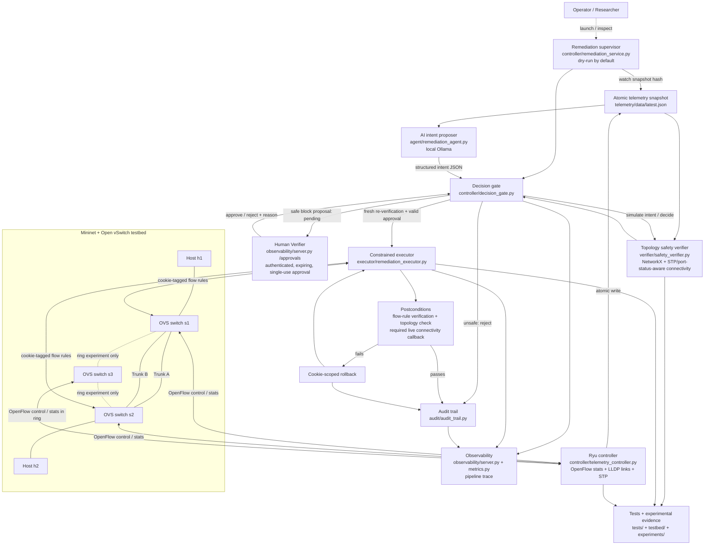

# Agentic AI-NetOps Guardrail

Agentic AI-NetOps Guardrail is a research prototype for AI-assisted network operations in a Mininet/Open vSwitch lab. A local AI intent proposer is separated from topology-aware verification, human authorization, constrained execution, post-change checks, and tamper-evident audit logging. The default operating mode is dry-run; a safe proposal is not itself approval or execution.

## Architecture

The diagram below is reused from [`docs/architecture_overview.md`](docs/architecture_overview.md).



## Quickstart

**Requirements:** Python 3.10, Git, and (for live lab operation) Mininet, Open vSwitch, Ryu, and a local Ollama service/model. The automated unit suite does not require a running Mininet topology.

```bash
git clone https://github.com/JeevanBennur1234/Agentic-ai-netops-guardrail.git
cd Agentic-ai-netops-guardrail
export NETOPS_HOME="$(pwd)"

python3.10 -m venv "$NETOPS_HOME/.venv"
source "$NETOPS_HOME/.venv/bin/activate"
# Ryu 4.34 needs legacy setuptools APIs and pbr during metadata generation.
python -m pip install --upgrade pip
python -m pip install "setuptools==58.0.4" wheel pbr
python -m pip install --no-build-isolation -r requirements.txt

# Apply the tracked Ryu 4.34 STP compatibility fix (idempotent).
./scripts/apply_ryu_stplib_compat_patch.sh

python -m pytest -q
```

### Ryu 4.34 STP compatibility

The lab uses a small, tracked compatibility patch for Ryu 4.34's `ryu.lib.stplib`. Ryu's original port-state comparison treats STP-managed OpenFlow config-bit updates as physical link transitions, which can incorrectly trigger STP link-up handling. The patch compares only physical carrier-down and administrative-down flags. It is kept as a patch file rather than editing `site-packages` manually, and the apply script checks the Ryu version, performs a dry run, and is safe to run more than once. Reapply it after recreating the virtual environment.

For the local observability dashboard, activate the environment above and run:

```bash
"$NETOPS_HOME/start_local_observability.sh"
```

The launcher creates local development credentials under your user configuration directory, outside the repository. For a live testbed, start the Ryu controller and Mininet/OVS using [`docs/live_demo_runbook.md`](docs/live_demo_runbook.md). Live network tests can alter the lab topology and are intentionally not part of the default CI job.

## Tests

Run the full unit suite from the repository root:

```bash
python -m pytest -q
```

GitHub Actions runs this command on pushes and pull requests using Python 3.10.

## Documentation

See the [`docs/`](docs/) directory for architecture, setup, live demo instructions, implementation inventory, threat model, experiment notes, and known limitations.

## Current evidence and claims

Latest local regression run: **176 tests passed**.

### Supported claims (with qualifications)
- A local AI intent proposer is integrated with a separate topology-aware safety gate.
- The graph verifier checks a limited set of topology and reachability invariants with STP-aware forwarding; it is not a formal proof of arbitrary packet behavior.
- Human approval is authenticated, reasoned, expiring, fingerprint-bound and single-use in tested software paths.
- Executor actions are constrained, cookie-tagged and checked after mutation, with scoped rollback attempts.
- Audit records are signed/hash-linked and tamper tests exist.
- Five 90-second active-trunk failover trials passed in the Mininet + OVS + Ryu emulated testbed (trials 02, 03, 06, 07, 08). Recovery ranged from 9.042 to 10.131 seconds; all five recorded zero packet-loss samples after recovery.
- The failover fault was injected using OpenFlow 1.3 administrative port-down. This is not a physical cable-unplug test and does not demonstrate AI-driven remediation.
- Live OVS executor latency was measured in five lab transactions; median 86.863 ms. This small sample is not a production latency guarantee.

### Do not claim
- Production readiness or a production SLA.
- Formal proof of the whole network.
- General 100% AI accuracy. The 30-case Qwen run achieved 30/30 valid JSON and schema passes with 0 fallbacks on the defined synthetic set; this measures structured-output compliance on that set, not general decision accuracy. Two unsafe mutating proposals were blocked by the independent guardrail; none passed.
- That the LLM autonomously performed the successful STP failover.
- Physical cable-unplug coverage.
- That failover is guaranteed to complete within 10 seconds in every environment.
- That a verifier result equals human approval or successful execution.
- A real Issue 2 anomaly when the mode is `controlled_simulation`.
- That no other network verifiers exist.

See [docs/CLAIMS_EVIDENCE.md](docs/CLAIMS_EVIDENCE.md) for the detailed evidence matrix and limitations.
