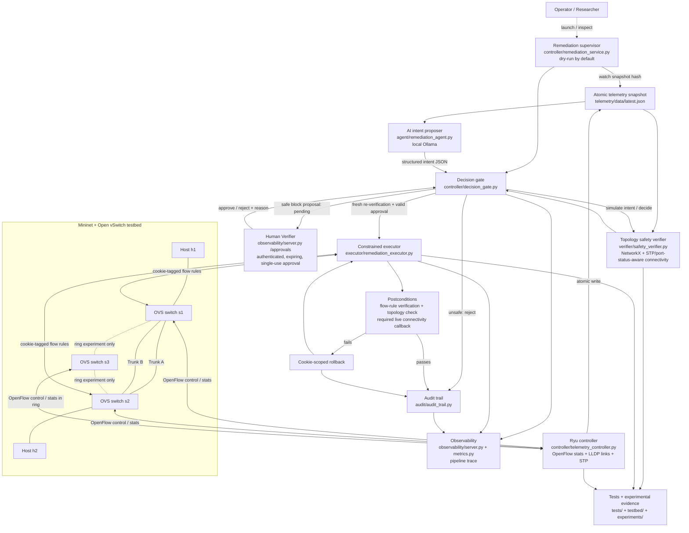

# Agentic AI-NetOps Guardrail

Agentic AI-NetOps Guardrail is a research prototype for AI-assisted network operations in a Mininet/Open vSwitch lab. A local AI intent proposer is separated from topology-aware verification, human authorization, constrained execution, post-change checks, and tamper-evident audit logging. The default operating mode is dry-run; a safe proposal is not itself approval or execution.

## Architecture

The diagram below is reused from [`docs/architecture_overview.md`](docs/architecture_overview.md).



## Quickstart

**Requirements:** Python 3.10, Git, and (for live lab operation) Mininet, Open vSwitch, Ryu, and a local Ollama service/model. The automated unit suite does not require a running Mininet topology.

```bash
git clone https://github.com/JeevanBennur1234/Agentic-ai-netops-guardrail.git
cd Agentic-ai-netops-guardrail
export NETOPS_HOME="$(pwd)"

python3.10 -m venv "$NETOPS_HOME/.venv"
source "$NETOPS_HOME/.venv/bin/activate"
# Ryu 4.34 requires an older setuptools API during its build.
python -m pip install --upgrade pip
python -m pip install "setuptools==67.6.1" wheel
python -m pip install --no-build-isolation -r requirements.txt

python -m pytest -q
```

For the local observability dashboard, activate the environment above and run:

```bash
"$NETOPS_HOME/start_local_observability.sh"
```

The launcher creates local development credentials under your user configuration directory, outside the repository. For a live testbed, start the Ryu controller and Mininet/OVS using [`docs/live_demo_runbook_2026-10-28.md`](docs/live_demo_runbook_2026-10-28.md). Live network tests can alter the lab topology and are intentionally not part of the default CI job.

## Tests

Run the full unit suite from the repository root:

```bash
python -m pytest -q
```

GitHub Actions runs this command on pushes and pull requests using Python 3.10.

## Documentation

See the [`docs/`](docs/) directory for architecture, setup, live demo instructions, implementation inventory, threat model, experiment notes, and known limitations.

## Claims

## 18. Safe claims and claims to avoid

### Safe to claim
- A local AI intent proposer is integrated with a separate topology-aware safety gate.
- The graph verifier checks a limited set of topology and reachability invariants with STP-aware forwarding.
- Human approval is authenticated, reasoned, expiring, fingerprint-bound and single-use.
- Executor actions are constrained, cookie-tagged and checked after mutation, with rollback attempts.
- Audit records are signed/hash-linked and tamper tests exist.
- The current Human Verifier has readable summaries and technical details.
- Issue 2 has a live telemetry detector plus a labelled controlled-simulation path.
- The most recent full test suite passed 169 tests.
- Standby-trunk integration passed in the recorded live test.
- The active-link failover experiment did not pass, while restoring the original path recovered connectivity.

### Do not claim
- Production readiness.
- Formal proof of the whole network.
- General 100% AI accuracy from 12 synthetic cases.
- Real OVS/data-plane latency from the fake-runner benchmark.
- Safe verifier result equals human approval or successful execution.
- A real Issue 2 anomaly when the mode is controlled_simulation.
- Successful automatic active-link failover.
- Physical cable-unplug coverage from the recorded emulated/admin-down test.
- That no other network verifiers exist.
