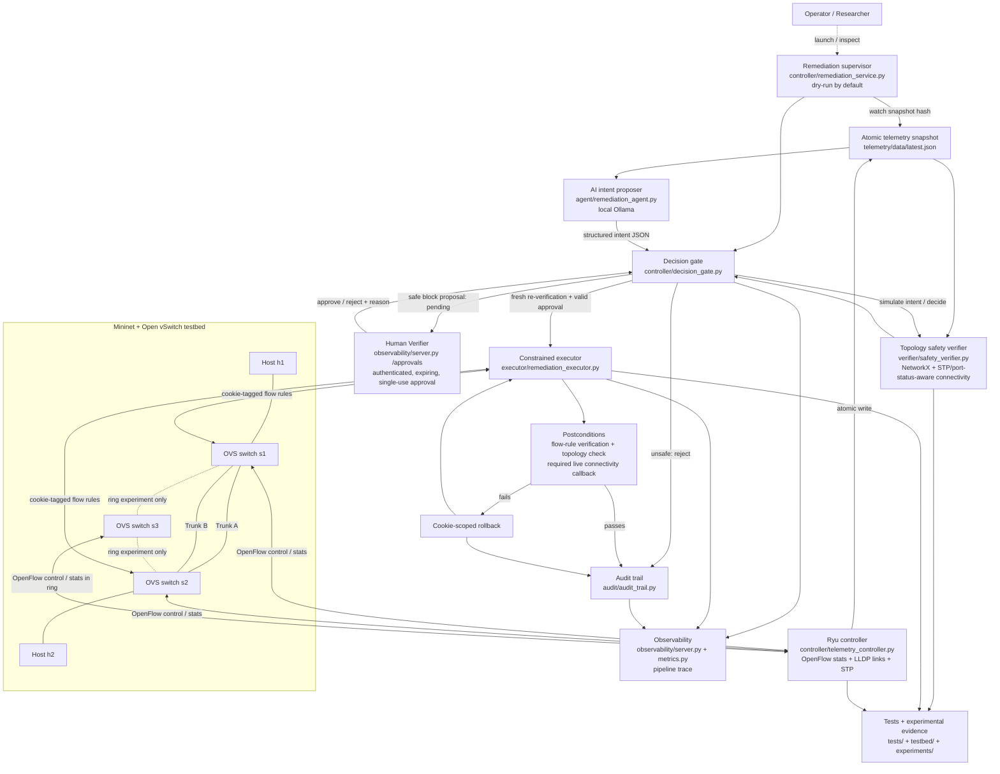

# Agentic AI-NetOps Guardrail — Complete Project Implementation Inventory

> Before running these examples, set NETOPS_HOME to the repository root and activate the Python environment: export NETOPS_HOME="$(pwd)" followed by source "$NETOPS_HOME/.venv/bin/activate".


**Prepared:** 28 October 2026
**Repository:** https://github.com/JeevanBennur1234/Agentic-ai-netops-guardrail
**Branch reviewed:** master
**Latest code commit at preparation:** 16ad240 — Add guarded remediation workflow and readable Human Verifier UI
**Environment:** WSL Ubuntu 22.04 on Windows
**Project root:** $NETOPS_HOME

> This inventory describes implemented code, recorded test evidence, live experiments, and known limitations. It distinguishes real live-test results from synthetic or simulated results and does not claim production readiness.

## Contents

1. Summary and project goals
2. Technology and topology
3. End-to-end architecture
4. Every major component
5. AI proposal and safety-gate behavior
6. Human Verifier and approval lifecycle
7. Executor, post-checks, rollback, audit
8. Dashboard, API and issue workflows
9. Security controls
10. Test suite inventory
11. Evaluation results
12. Live lab results and limitations
13. Repository file inventory
14. Development milestones
15. Setup and operations commands
16. Guide/viva explanation
17. Claims that are safe to make
18. Final checklist
19. Full existing project documents as appendices

## 1. Summary and project goals

Agentic AI-NetOps Guardrail is a research prototype for safer AI-assisted network remediation in a software-defined network (SDN). It integrates a local language-model intent proposer, Ryu network telemetry, a NetworkX topology safety verifier, a decision gate, an authenticated Human Verifier, a constrained Open vSwitch executor, post-change checks, scoped rollback attempts, and a signed/hash-linked audit trail.

The governing principle is:

**AI proposes → independent code verifies → human authorizes → constrained executor acts → post-checks and audit record the result.**

The repository also includes an interactive topology dashboard, two issue-specific proposal workflows, a readable Human Verifier UI, Prometheus metrics endpoints/configuration, experiment and benchmark tools, live Mininet/OVS validation scripts, research notes, a system design/threat model, presentation guidance, and a demo runbook.

### Current status snapshot

- The latest recorded full pytest run on 28 October 2026 passed 169 tests, with one upstream eventlet/distutils deprecation warning.
- Twelve manually labelled synthetic safety cases matched the expected safety labels. This is evidence for that small deterministic test set, not a measurement of general LLM accuracy.
- Thirty simulated executor transactions passed using an in-memory fake OVS command runner. No real OVS commands or live connectivity tests were run by that benchmark.
- The recorded two-switch redundant-topology baseline passed with 0% ping loss.
- A live standby-trunk rule test checked paired rules and continued connectivity, and rejected selected unsafe access-port/active-trunk requests.
- Automatic active-link failover is not working/verified in the current live failure experiment. The alternate link remained STP-blocked, packet loss rose to 100%, and connectivity recovered only after the original link was restored.
- Production readiness is not established.

### Project goals

1. Collect current network state from a Ryu/Mininet/Open vSwitch environment.
2. Give a local model sanitized telemetry and valid physical-port information.
3. Ask the model for a structured remediation intent instead of a shell command.
4. Validate schema, action, switch and port.
5. Check graph connectivity, endpoint reachability, loop policy, and the effect of a proposed port removal.
6. Reject unsafe, malformed, unsupported, stale, or unaudited operations.
7. Route eligible safe block actions to human review instead of executing immediately.
8. Bind approval to the exact intent, verifier result, and topology fingerprint.
9. Enforce expiry, a human reason, authentication and one-time approval consumption.
10. Revalidate again immediately before execution.
11. Use constrained cookie-tagged flow rules, post-verification, and a real connectivity callback where required.
12. Attempt rollback when an execution postcondition fails.
13. Record decisions and outcomes in the signed/hash-linked audit trail.
14. Provide a dashboard, trace/metrics APIs, repeatable tests, experiment output, and documentation.

### Correct contribution statement

The defensible contribution is the integration of an LLM intent proposer, a topology-aware safety gate, a constrained executor, human authorization, audit, and Mininet-based evaluation. This project does not claim equivalence to formal verifiers such as Header Space Analysis, VeriFlow, or NetKAT.

## 2. Technologies and topology

### Technologies

| Technology | Role |
|---|---|
| Python | Agent, verifier, gate, executor, approval store, audit, server, tests and experiments. |
| WSL Ubuntu 22.04 | Local development and test environment. |
| Mininet | Emulates hosts, links, and switches. |
| Open vSwitch | Virtual switches and OpenFlow rules. |
| OpenFlow 1.3 | Controller/switch protocol. |
| Ryu | SDN controller and telemetry event source. |
| LLDP/link discovery | Discovers links between switches. |
| STP | Prevents Layer-2 loops by blocking redundant paths. |
| Ollama | Runs a local LLM. |
| qwen2.5-coder:1.5b | Model referenced by project notes as the local default; runtime model selection is configurable. |
| NetworkX | Graph-based topology invariants. |
| Flask-style HTTP server | Dashboard, Human Verifier, API, metrics and trace. |
| Prometheus/Grafana assets | Monitoring configuration, metrics and dashboard/schema support. |
| pytest | Automated test suite. |
| Git/GitHub | Source control and remote repository. |

### Local paths and URLs

- Project root: $NETOPS_HOME
- Python interpreter: $VIRTUAL_ENV/bin/python
- Dashboard: http://127.0.0.1:8000/dashboard
- Human Verifier: http://127.0.0.1:8000/approvals
- Health: http://127.0.0.1:8000/health
- Ryu/OpenFlow listener: 127.0.0.1:6653
- Git remote: https://github.com/JeevanBennur1234/Agentic-ai-netops-guardrail.git

### Main topology

The main network is created by testbed/redundant_topo.py. It has hosts h1 and h2, switches s1 and s2, and two inter-switch trunks:

- Primary trunk: s1-p2 ↔ s2-p1.
- Standby trunk: s1-p3 ↔ s2-p2.
- Host-facing ports include s1-p1 and s2-p3.

A typical healthy state has the primary trunk and host access ports forwarding, with at least one standby endpoint blocked by STP. For example, s1-p3=FORWARD and s2-p2=BLOCK is normal redundancy behavior, not an anomaly by itself.

A three-switch/ring topology is used by dedicated failover and diagnostic scripts; it is not assumed to run simultaneously with the standard two-switch topology.

## 3. End-to-end architecture

1. Ryu polls OpenFlow port/flow statistics and receives switch, link-discovery, STP and port-status events.
2. The telemetry controller writes a timestamped JSON snapshot using a temporary file and atomic replacement.
3. The agent sanitizes telemetry and asks the local model for structured intent JSON.
4. Schema checks and telemetry-derived target checks reject malformed output or invalid ports.
5. The NetworkX verifier builds a graph and checks connectivity, reachability, loop policy, and simulated port removal.
6. The decision gate rejects an unsafe proposal or records an eligible safe block proposal as PENDING_HUMAN_APPROVAL.
7. The authenticated Human Verifier shows the proposal and records approve, reject, or request-changes plus an audit reason.
8. Execution is separate. The execution endpoint verifies that the approval exists in the audit chain and checks the proposal/topology again.
9. The constrained executor applies the permitted change using cookie-tagged flow rules at both ends of a selected trunk.
10. Flow, topology, and configured connectivity postconditions are checked.
11. If a required postcondition fails, scoped rollback is attempted and its result is recorded.
12. The audit trail, pipeline trace, metrics and dashboards provide evidence.

### Separate concepts

- Automated verifier safe result means only that the configured automated checks passed.
- PENDING_HUMAN_APPROVAL means a proposal is waiting for the operator.
- Approved means the operator authorized the exact proposal; the change may not have run yet.
- Execution success must be established from the executor result and relevant post-checks.

A passing verifier status is not human approval and is not proof that the network changed.

## 4. Every major component

### agent/remediation_agent.py

- Uses a local Ollama inference endpoint.
- Sanitizes telemetry and provides valid physical-port information.
- Requests structured JSON intent against a declared schema.
- Validates required fields, action names and target details.
- Validates physical ports against telemetry.
- Does not convert model prose into executable shell commands.
- Defaults safely, such as to no_action, when model output is invalid or the service fails.
- Supports incident-specific context, including honest Issue 2 controlled-simulation labeling.

agent/remediation_agent_gemini.py is also present as an additional agent-related module; the architecture notes identify remediation_agent.py/Ollama as the primary path.

### verifier/safety_verifier.py

- Loads telemetry and builds a graph from switches, ports, links and available status.
- Excludes local/reserved OpenFlow ports from valid physical targets.
- Builds a forwarding graph that respects STP and reported port state.
- When STP telemetry exists, a physical inter-switch link is not considered an available forwarding path unless both relevant endpoints report FORWARD.
- Checks topology existence, connectivity, loop policy, access-endpoint reachability and simulated port-removal effects.
- Handles incomplete state conservatively where it affects safety.
- Returns structured check results/reasons.

This is topology-level graph analysis, not complete symbolic verification of arbitrary OpenFlow matches/actions, packet headers, VLAN policy, middleboxes, or every network behavior.

### controller/decision_gate.py

- Integrates agent proposals and deterministic verification.
- Simulates action effects against the topology graph.
- Rejects invalid and unsafe actions.
- Routes eligible safe block actions into PENDING_HUMAN_APPROVAL without changing OVS at proposal time.
- Revalidates approved proposals before execution.
- Adds decision evidence to audit and pipeline trace.
- Fails closed for unsupported reroute and unsafe trunk/access-port actions.
- Includes regression work around loop-free defaults and require_loop_free behavior.

### controller/telemetry_controller.py

- Ryu application for OpenFlow 1.3.
- Handles switch features and datapath events.
- Requests/processes flow and port statistics.
- Discovers links and updates topology.
- Records STP state transitions and OpenFlow port-status events when reported.
- Publishes a timestamped snapshot using temporary-file writing and atomic replacement.
- Uses a project-local snapshot path so sudo/root execution does not cause the reader and writer to use different files.

Atomic replacement prevents partial JSON reads but does not make observations from multiple switches globally simultaneous. In the recorded link-down tests, an interface-down event did not produce the needed OpenFlow DOWN/MISSING signal, so correcting the telemetry path alone did not fix failover.

### controller/human_verifier.py

- Stores intent, verifier result, requester, status, creation/expiry, fingerprints and decision.
- Computes topology and exact proposal fingerprints.
- Defaults to a 300-second/five-minute approval lifetime.
- Rejects missing or unsafe verifier results.
- Deduplicates identical unexpired pending proposals by fingerprint.
- Uses a process lock and atomic file update.
- Requires an authenticated approver, a matching fingerprint, and a non-empty decision reason.
- Supports approve, reject and request-changes.
- Refuses expired or non-pending decisions.
- Revalidates intent/verifier/topology before execution and consumes approval once.

### controller/remediation_service.py

- Watches telemetry file content fingerprints.
- Runs the decision pipeline when the snapshot changes.
- Defaults to dry-run.
- Execute mode requires an explicit module:function connectivity checker.
- Reports invalid checker configuration or failed executor results.
- Is a manually launched component, not an installed persistent OS service.

### executor/remediation_executor.py

- Independently validates actions, targets and stored human approval.
- Rejects malformed/nonexistent targets, reserved/local ports, access-port blocks and unsupported operations.
- Restricts live block operations to eligible inter-switch trunks.
- Does not accept a caller-supplied APPROVED string as sufficient authorization.
- Requires a live connectivity checker by default for block execution.
- Uses argument-array subprocess calls rather than shell command concatenation.
- Adds cookie/transaction-tagged drop rules at both ends of a selected trunk.
- Checks for conflicts with existing flow rules.
- Verifies installed flow entries and topology safety.
- Runs live connectivity post-checks when configured/required.
- Attempts scoped rollback and reports rollback failure honestly.

Reroute remains rejected until forwarding-aware verification exists.

### audit/audit_trail.py

- Canonically serializes audit payloads.
- Maintains previous-hash-linked records.
- Signs records using ECDSA-based signing material.
- Persists and reloads the chain.
- Verifies hashes, signatures and chain links.
- Has tests for altered intent, decision, verifier result, timestamps, signature, hash links, deleted intermediate records, corrupt key behavior and file permissions.

This is application-level tamper-evident evidence, not independent hardware attestation.

### observability/server.py and observability/metrics.py

- Serve health/status, dashboard, Human Verifier, topology, trace, audit chain and metrics.
- Protect proposal-trigger actions with configured operator tokens.
- Require an approver-token map for approval APIs.
- Append human decision trace events so later human actions are visible separately from the original AI proposal.
- Prevent execution if approval/audit/connectivity prerequisites are missing or invalid.
- Implement Issue 1 and Issue 2 endpoints.

### dashboard/index.html

- Interactive topology graph and live refresh.
- Pipeline trace with decision/check/reason/time.
- Audit/observability sections.
- Link to Human Verifier.
- Issue 1 Inject Fault → AI Proposal button.
- Issue 2 Standby Forwarding button.
- Protected operator token prompt.
- Error and proposal-created messages.
- Lifecycle-aware status tint: pending is amber; approved-but-not-executed is blue; a safety pass is green only when no stronger active lifecycle state overrides it, or execution success is confirmed.

This was changed because “VERIFIER: SAFE” looked like human approval even while the actual proposal was still pending.

### Human Verifier UI

The raw JSON is no longer the primary presentation. Proposal cards provide:
- Issue details in plain language.
- Changes to address the issue.
- Automated safety checks with individual results.
- Your Decision with required reason and Approve/Reject/Request changes.
- Collapsible technical details for fingerprints, timestamps, target data and original reason.
- Separate approved-but-not-executed state and separate Execute approved action button.
- Rejected, changes-requested and consumed states with clear wording.
- A warning not to claim success until execution and connectivity checks confirm it.

### Other modules

- testbed/live_connectivity.py: checks actual host-to-host reachability in the current Mininet lab and fails closed if a host is missing.
- observability/prometheus.yml: Prometheus scrape configuration.
- experiments/experiment_suite.py: structured experiment suite.
- experiments/runner.py: runs suite and creates report output.
- experiments/benchmark.py: component benchmark utility.
- experiments/topologies.py: synthetic topology builders.
- experiments/evaluate_guardrail_cases.py: newer manually labelled safety cases and fake-runner executor benchmark.
- dashboard/index.html: user-facing topology/pipeline view.
- testbed/: topology, demo approval, diagnostics and live validation scripts.
- tests/: automated regression coverage.

## 5. AI proposal and safety-gate behavior

The agent receives sanitized telemetry, links/ports, STP evidence and relevant incident context. It outputs an intent such as no_action or block. Although reroute appears in the action vocabulary, it is intentionally rejected downstream until safe forwarding-aware verification exists.

Validation includes:
- Structured schema validation.
- Supported action checking.
- Physical-port and switch target validation against current telemetry.
- Rejection of local/reserved OpenFlow ports and fabricated targets.
- Safe fallback when the model output or model service fails.
- Independent graph verification rather than trusting the model’s claimed safety.

The deterministic verifier checks topology existence, connectivity, loop policy, endpoint reachability, and effects of a candidate port removal. A link being physically discovered does not automatically mean it is forwarding: STP and reported port status matter.

## 6. Human approval and execution

Approval configuration:
- NETOPS_APPROVER_TOKENS: JSON mapping operator IDs to long random tokens.
- NETOPS_CHAOS_API_TOKEN: token for protected proposal-trigger endpoints.
- NETOPS_CONNECTIVITY_CHECKER: environment-specific module:function for live connectivity checks.

Approval behavior:
- Five-minute expiry by default.
- A decision reason is mandatory.
- Fingerprint must match the exact stored proposal.
- Stale or changed topology is rejected.
- Duplicate unexpired pending proposals can reuse an existing ID.
- Approval is used once and cannot be replayed.
- A matching audit record is required before execution.
- Execution rechecks proposal, topology and the live checker.
- Approval is separate from execution.

Keep tokens out of source control, screenshots, chat, URLs and slides. The local development server should not be exposed to untrusted networks.

## 7. Executor, post-checks, rollback and audit

A block action is restricted to an eligible inter-switch trunk with an alternate topology path. The executor installs cookie-tagged drop rules at both ends. It checks expected rules, checks topology safety, and requires a live connectivity checker by default. A successful OVS command alone is not proof that hosts can still communicate.

If a required postcondition fails, the executor attempts to remove only rules associated with its own transaction and reports whether rollback was verified. The audit trail records decisions and results using a hash-linked, signed record sequence.

## 8. Issue 1 — controlled redundant-trunk workflow

Issue 1 is the Inject Fault → AI Proposal demonstration path. It is not a real primary-link failure injector and does not deliberately create a broadcast loop in the current implementation.

The recorded behavior:
- Checks topology and live connectivity.
- Ensures/restores the standby path/interfaces for the controlled scenario.
- Reconciles pre-existing guardrail drop rules on standby ports where necessary.
- Verifies link/port/telemetry conditions.
- Runs the AI and safety gate.
- Can propose blocking switch 1, port 3 (s1-p3) to isolate the standby trunk for review.
- Creates PENDING_HUMAN_APPROVAL rather than executing at proposal time.

Describe it as controlled standby-trunk proposal/review workflow—not proof of a real loop or primary-path failure.

## 9. Issue 2 — standby-forwarding detection

The detector is in controller/standby_anomaly.py and the protected route is /api/chaos/standby-forwarding?confirm=true.

A real anomaly requires:
- Telemetry no older than 30 seconds.
- Both trunks and expected ports discovered.
- Both primary endpoints FORWARD.
- Both host-facing ports FORWARD.
- Both standby endpoints simultaneously FORWARD.

A normal state with one standby endpoint STP-blocked is not an anomaly.

When the real condition is absent, an explicitly chosen controlled simulation can demonstrate review workflow without mutating OVS/STP or fabricating telemetry. It is labelled controlled_simulation, and the AI reason says the signal is simulated. It can create a review-only proposal, not automatically execute it.

Tests cover healthy state, both-end forwarding detection, stale telemetry, missing link, no proposal without anomaly/simulation, and safe simulation semantics. During the latest observed lab check, s1-p3 was FORWARD while s2-p2 was BLOCK, so the live dual-forwarding anomaly was absent.

## 10. Security controls

| Risk | Control | Remaining work |
|---|---|---|
| Invalid or hallucinated intent | Schema and target validation, safe fallback. | More adversarial model-output evaluation. |
| Fabricated switch/port | Telemetry-derived target validation. | Coherent multi-switch snapshot remains a challenge. |
| Access-port outage | Gate and executor reject access-port block. | Broader VLAN/host cases. |
| Unsafe reroute | Fail-closed rejection. | Implement forwarding-aware verification first. |
| Shell injection | Intent is not a command; use argument arrays/shell=False. | Preserve in all extensions. |
| Stale telemetry | Timestamp freshness check. | Snapshot is not globally atomic across switches. |
| Changed topology after approval | Fingerprints and fresh validation. | More concurrency/race testing. |
| Forged/replayed approval | Authenticated stored approval, audit binding and one-time consume. | Continue regression testing. |
| Partial rule installation | Paired rules and scoped rollback. | More one-sided failure injection. |
| Connectivity loss | Live callback and postcondition with rollback attempt. | Active failover still unresolved. |
| Audit alteration | Signed/hash-linked chain. | Operational key custody/rotation/backup. |
| Secret exposure | Environment tokens and ignored local runtime/keys. | Rotate if a secret is exposed. |

## 11. Test suite inventory

There are 13 current pytest test modules; parameterized tests make the number of executed test cases larger than literal test-function count.

| Test module | Main coverage |
|---|---|
| tests/test_adversarial.py | Missing/malformed fields, unsupported actions, invalid targets, reserved port, injection-shaped target, access-port isolation, unsafe block. |
| tests/test_agent_incident_context.py | Sanitization, structured proposal context, Issue 2 simulation labeling. |
| tests/test_audit_trail.py | Chain creation/persistence, signature/hash tamper, broken links, deleted entry, corrupt key, permissions. |
| tests/test_demo_approval.py | Demo candidate selection, verifier pass, trace record. |
| tests/test_experiments.py | Experiment suite, topologies, benchmark stats, normal/unsafe/adversarial/audit/observability behavior. |
| tests/test_guardrail.py | Target validation, schema, topology/loop/reachability, STP-aware paths, port-status down. |
| tests/test_human_verifier.py | Fingerprints, expiry, single-use, reason, topology tamper, request changes, forged approval, connectivity prerequisite. |
| tests/test_live_connectivity.py | Bidirectional host connectivity and missing-host failure. |
| tests/test_observability.py | Health/metrics/dashboard, read-only invariant, auth, approvals, execution, trace, Issue 1/2 and readable UI. |
| tests/test_recommended_evaluation.py | Synthetic safety metrics and fake-OVS transaction benchmark. |
| tests/test_remediation_executor.py | Allowed/refused execution, invalid target, bypass attempts, post-check, rollback and failure reporting. |
| tests/test_remediation_service.py | Dry-run, telemetry fingerprints, callable loader, execute prerequisite, failures. |
| tests/test_standby_anomaly.py | Healthy STP, actual dual-forwarding, stale telemetry and missing-link behavior. |

Latest full run: **169 passed, 1 warning**. The warning is an upstream eventlet/distutils deprecation. Passing tests are not a substitute for live network tests.

## 12. Evaluation results

### Synthetic labelled safety cases

- 12 manually labelled cases: 3 safe, 9 unsafe.
- 12/12 matched their expected labels.
- 0 false accepts among the 9 unsafe cases.
- 0 false rejects among the 3 safe cases.

These figures are only for this small deterministic fixture set; they do not demonstrate the language model is 100% accurate.

### Simulated executor transactions

- 30 requested, 30 passed, 0 failed.
- Mean 0.277 ms; median 0.221 ms; p95 0.380 ms; min 0.212 ms; max 1.279 ms.
- Used in-memory fake OVS command runner.
- Did not execute actual OVS commands or test live connectivity.

These are simulated software-path timings, not live data-plane latency.

## 13. Live testbed results

### Redundant topology baseline — PASS

The recorded two-switch topology converged with one standby endpoint blocked and host access ports forwarding. Baseline ping loss was 0%.

### Paired standby-trunk rules — PASS

The recorded test installed and verified cookie-tagged drop rules at both ends of the standby trunk; post-test connectivity reported 0% loss. An access-port block was rejected without changing checked rules. The gate and executor also refused a block of the active trunk when the alternate was STP-blocked; those refusals did not change the checked flow rules and host connectivity remained intact. A temporary audit chain verified.

This demonstrates bounded standby-rule execution and safe refusal; it does not demonstrate active-link failover.

### Active-link failover — FAILOVER_FAILED_ROLLBACK_PASS

The recorded failure experiments started with 0% loss, then emulated an active-path failure. Ryu did not report the needed OpenFlow DOWN/MISSING event, the alternate trunk remained STP-blocked, and loss reached 100% during the failover window. Restoring the original trunk returned connectivity to 0% loss.

The injected event used Mininet/Linux interface-down or configLinkStatus-style behavior, not a confirmed physical cable unplug. Correcting the telemetry path and making STP-priority setup deterministic did not make the latest failover test pass. Automatic active-link failover is therefore unresolved and must not be described as working.

## 14. Repository file inventory

### Agent
- agent/remediation_agent.py — Ollama intent proposer, sanitizer, schema/target validation.
- agent/remediation_agent_gemini.py — additional agent-related module.

### Controller and safety
- controller/telemetry_controller.py — telemetry collection.
- controller/decision_gate.py — safety gate and pipeline.
- controller/human_verifier.py — approval store and lifecycle.
- controller/remediation_service.py — snapshot watcher/supervisor.
- controller/standby_anomaly.py — Issue 2 detector.
- verifier/safety_verifier.py — NetworkX safety checks.
- executor/remediation_executor.py — constrained changes, checks, rollback.

### Audit, UI and observability
- audit/audit_trail.py — signed/hash-linked log.
- observability/server.py — UI and APIs.
- observability/metrics.py — metrics.
- observability/prometheus.yml — Prometheus settings.
- dashboard/index.html — topology dashboard and issue controls.

### Testbed
- testbed/redundant_topo.py — main topology.
- testbed/live_connectivity.py — real connectivity checker.
- testbed/create_demo_approval.py — review-only proposal helper.
- testbed/diagnose_link_down.py — link-down diagnostics.
- testbed/validate_redundant_topology.py — baseline test.
- testbed/validate_trunk_remediation.py — two-ended rule/post-check test.
- testbed/validate_active_failover.py — active failure validation.
- testbed/validate_triangle_failover.py — ring failover/rollback test.

### Experiments
- experiments/experiment_suite.py — structured scenarios.
- experiments/runner.py — runs and reports experiments.
- experiments/benchmark.py — component/transaction benchmarks.
- experiments/topologies.py — synthetic topologies.
- experiments/evaluate_guardrail_cases.py — current synthetic safety and fake-runner transaction evaluation.
- experiments/results/recommended_evaluation_20261027.json and .md — evaluation results.
- experiments/results/live_integration_summary_20261027.json — live integration summary.
- experiments/results/live_active_failover_latest.json — active failure record.
- experiments/results/live_triangle_failover_latest.json — ring failure record.
- experiments/results/link_down_diagnostic_20261027.md — link-down diagnosis.

### Tests and existing docs
- 13 tests files are listed in Section 11.
- Existing docs: architecture overview, Human Verifier setup, dated implementation status, Issue 2, literature/research gap, live demo runbook, presentation update notes, and system design/threat model.

Runtime snapshots, audit runtime data, signing keys, Python caches, and runtime logs are not source features. The latest pushed project version removed six experiment private-key files from the Git index and ignores generated runtime logs/caches. Never commit tokens or private key values.

## 15. Development milestone history

| Commit | Recorded message |
|---|---|
| 0908443 | Milestone 3: controlled remediation execution with OVS post-verification and audit extension. |
| decca31 | Milestone 4: Prometheus observability and Grafana configuration. |
| 01ddc25 | Milestone 5: experiments and performance benchmarking. |
| 2d31646 | Milestone 6: live topology discovery and evaluation rigor. |
| fc24314 | Interactive dashboard, live topology testbed and benchmarks. |
| fa58a40 | Harden agent schema validation and normalize missing reason. |
| f8a9500 | Safety-verifier fixes for redundant topology, reachability and path fallback. |
| 4651c53 | Fail-closed loop policy, trace logging, dashboard API and live UI. |
| 2132653 | Loop-policy override regression fix, dashboard Phase 1–3, regression tests. |
| 16ad240 | Guarded remediation workflow and readable Human Verifier UI. |

The last pre-inventory push was verified with local HEAD equal to origin/master at 16ad240 and a clean working tree. This inventory will be a new documentation commit.

## 16. Setup and operation commands

### Preflight

    cd "$NETOPS_HOME"
    test -x $VIRTUAL_ENV/bin/python && echo "Python venv OK"
    pgrep -af '[r]yu-manager' || true
    pgrep -af '[o]bservability/server.py' || true
    sudo ovs-vsctl list-br
    ss -ltnp | grep -E '6653|8000' || true

Do not start duplicate Ryu, server, or Mininet if it is already running.

### Start Ryu if stopped

    cd "$NETOPS_HOME"
    sudo -E $VIRTUAL_ENV/bin/ryu-manager --ofp-tcp-listen-port 6653 controller/telemetry_controller.py

### Configure tokens and start the local server

Use strong, different secrets and keep them private.

    cd "$NETOPS_HOME"
    export NETOPS_CHAOS_API_TOKEN="REPLACE_WITH_LONG_RANDOM_OPERATOR_TOKEN"
    export NETOPS_APPROVER_TOKENS='{"netops-admin":"REPLACE_WITH_DIFFERENT_LONG_RANDOM_APPROVER_TOKEN"}'
    export NETOPS_CONNECTIVITY_CHECKER='testbed.live_connectivity:check_host_connectivity'
    $VIRTUAL_ENV/bin/python observability/server.py

If health already returns OK, keep the existing server instead of starting a duplicate. The development server should remain local unless proper remote access controls and HTTPS are configured.

### Start the Mininet lab only when no conflicting bridges exist

    sudo ovs-vsctl list-br
    cd "$NETOPS_HOME"
    sudo mn --custom $NETOPS_HOME/testbed/redundant_topo.py --topo redundant --controller=remote,ip=127.0.0.1,port=6653 --switch ovs,protocols=OpenFlow13

At mininet>, run nodes, net, links, pingall. Allow STP and LLDP telemetry to settle.

### Verify health, connectivity and telemetry

    curl -fsS http://127.0.0.1:8000/health
    sudo ovs-vsctl list-br
    $VIRTUAL_ENV/bin/python -m testbed.live_connectivity

    $VIRTUAL_ENV/bin/python - <<'PY'
    import json
    with open("telemetry/data/latest.json", encoding="utf-8") as f:
        data = json.load(f)
    print("Updated:", data.get("updated_at_utc"))
    print("Links:", data.get("links", []))
    for switch, details in data.get("switches", {}).items():
        print("Switch", switch, details.get("stp_port_states", {}))
    PY

### Run tests and synthetic evaluation

    $VIRTUAL_ENV/bin/python -m pytest -q
    $VIRTUAL_ENV/bin/python experiments/evaluate_guardrail_cases.py
    cat experiments/results/recommended_evaluation_20261027.md

### Inspect flow rules

    sudo ovs-ofctl -O OpenFlow13 dump-flows s1
    sudo ovs-ofctl -O OpenFlow13 dump-flows s2
    sudo ovs-ofctl -O OpenFlow13 dump-flows s1 | grep 'priority=65500' || true
    sudo ovs-ofctl -O OpenFlow13 dump-flows s2 | grep 'priority=65500' || true

Do not remove flows blindly. Confirm their owner and transaction first.

## 17. Suggested demonstration and viva explanation

### Safe demo sequence

1. Preflight controller, server, OVS bridges and Mininet.
2. Confirm pingall and the live connectivity callback.
3. Show discovered topology and STP state.
4. Trigger Issue 1 or Issue 2 proposal workflow.
5. If Issue 2 is controlled simulation, say explicitly that the real anomaly was absent.
6. Show Issue details, Changes to address the issue, Automated safety checks, and Your Decision in Human Verifier.
7. Explain that a pending proposal is not executed.
8. For a safe review demonstration, reject or request changes with a reason. Execute only when a real checker and lab impact are understood.
9. Show audit and trace record.
10. In a separate isolated run, use the validated standby-trunk test and show the post-check.
11. Show test/evaluation output and label the synthetic/fake-runner evidence correctly.
12. Explain the unresolved failover result honestly.

### Simple explanation to a guide

My project is Agentic AI-NetOps Guardrail. It uses a local AI model to suggest network fixes, but it does not let the AI change the network directly. Ryu collects information from the Mininet and Open vSwitch lab. The model proposes a structured action, and a separate graph-based safety verifier checks the topology, connectivity, reachability and configured loop policy.

If a block proposal passes the automated checks, it goes to the Human Verifier and waits for an authorized operator. The operator can approve, reject, or request changes and must give a reason. The approval is tied to the exact proposal and current topology and can be used only once. The executor revalidates the approval, applies a limited trunk-block action, verifies the flow rules and live connectivity, and attempts rollback if a required check fails. The audit trail records the decisions and outcomes.

I have implemented the two proposal workflows, dashboard, readable Human Verifier, automated tests, synthetic evaluation and live testbed scripts. The two-switch baseline and standby-trunk rule test passed in the recorded environment. Automatic active-link failover after the tested failure remains unresolved, so I do not claim it works.

**Memorable line:** The AI proposes, the verifier checks, the human authorizes, the executor applies, and post-checks/audit record the result.

## 18. Safe claims and claims to avoid

### Safe to claim
- A local AI intent proposer is integrated with a separate topology-aware safety gate.
- The graph verifier checks a limited set of topology and reachability invariants with STP-aware forwarding.
- Human approval is authenticated, reasoned, expiring, fingerprint-bound and single-use.
- Executor actions are constrained, cookie-tagged and checked after mutation, with rollback attempts.
- Audit records are signed/hash-linked and tamper tests exist.
- The current Human Verifier has readable summaries and technical details.
- Issue 2 has a live telemetry detector plus a labelled controlled-simulation path.
- The most recent full test suite passed 169 tests.
- Standby-trunk integration passed in the recorded live test.
- The active-link failover experiment did not pass, while restoring the original path recovered connectivity.

### Do not claim
- Production readiness.
- Formal proof of the whole network.
- General 100% AI accuracy from 12 synthetic cases.
- Real OVS/data-plane latency from the fake-runner benchmark.
- Safe verifier result equals human approval or successful execution.
- A real Issue 2 anomaly when the mode is controlled_simulation.
- Successful automatic active-link failover.
- Physical cable-unplug coverage from the recorded emulated/admin-down test.
- That no other network verifiers exist.

## 19. Final checklist

### Implemented
- [x] Local AI structured intent proposal.
- [x] Telemetry sanitation and physical-port validation.
- [x] Ryu/OpenFlow statistics, link discovery, STP/port-status telemetry.
- [x] Timestamped atomic telemetry snapshot.
- [x] NetworkX topology/forwarding checks.
- [x] Decision gate and fail-closed rejection.
- [x] Pending human-approval lifecycle.
- [x] Authentication, decision reason, fingerprints, expiry and one-time consumption.
- [x] Separate approved execute endpoint.
- [x] Cookie-tagged two-ended trunk rules and post-check.
- [x] Scoped rollback attempts.
- [x] Live connectivity checker integration.
- [x] Signed/hash-linked audit.
- [x] Dashboard, metrics, topology, trace and approval APIs.
- [x] Issue 1 controlled proposal workflow.
- [x] Issue 2 detector and controlled simulation.
- [x] Human Verifier readability changes and regression test.
- [x] Testbed, experiments, documentation and automated test coverage.

### Tested in recorded environment
- [x] Full pytest run: 169 passed, one deprecation warning.
- [x] Human Verifier JavaScript syntax check.
- [x] Redundant topology baseline.
- [x] Standby-trunk paired rule and post-check.
- [x] Unsafe active-trunk/access-port refusal.
- [x] Audit-chain verification in live integration test.
- [x] 12/12 synthetic labelled cases.
- [x] 30/30 fake-OVS benchmark transactions.

### Still open/not proven
- [ ] Reliable active-link failure detection and alternate-path convergence.
- [ ] Successful live automatic active-link failover.
- [ ] Physical cable-unplug test.
- [ ] Broader independently labelled LLM quality evaluation.
- [ ] Safe forwarding-aware reroute verification.
- [ ] More partial-install and rollback-failure injections.
- [ ] Production operational hardening, key lifecycle, remote HTTPS deployment, persistent supervisor.

## 20. Full reference documents
The following existing project documents are reproduced below so the implementation inventory and the existing project notes are available in one file.


---

# Appendix A — Full architecture overview

_Source file: docs/architecture_overview.md — reproduced in full._

# Agentic AI-NetOps Guardrail - Full Architecture
Updated: 2026-10-27

## 1. Architecture diagram



The dashed ring links and s3 belong to the dedicated three-switch test. The primary redundant topology uses s1 and s2 connected by two trunks; all topologies are not necessarily running simultaneously.

## 2. Architectural planes

### Data plane
- Mininet hosts create traffic.
- Open vSwitch bridges forward packets using OpenFlow rules.
- Two inter-switch trunks create a redundant path.
- Ryu STP marks a port FORWARD or BLOCK to prevent Layer-2 loops.
- Mininet ping tests measure actual host connectivity.

### Control and safety plane
- Ryu collects port/flow stats, discovers links, records STP transitions and observes OpenFlow port-status events (UP/DOWN/MISSING).
- The controller publishes a timestamped telemetry snapshot through atomic file replacement at the project-local path by default, including when launched under sudo. The snapshot is readable by the project user.
- The topology builder converts switches, physical ports, links and STP state into a NetworkX graph.
- The local Ollama model proposes a structured action; its result is treated as untrusted input.
- The decision gate simulates the action against graph safety checks. Unsafe proposals are rejected; a safe block proposal is recorded as PENDING_HUMAN_APPROVAL and is not executed yet.
- The Human Verifier lives at observability/server.py (/approvals and /api/approvals). Operators authenticate with a server-configured bearer token and must approve/reject the exact intent, verifier result and topology fingerprint with a reason.
- Approval expires, is single-use, is recorded in the signed audit chain, and is revalidated against fresh telemetry immediately before execution. Missing, stale, changed or unaudited approval fails closed.
- The executor independently validates action and target, requires human approval and a live connectivity checker by default, supports trunk blocking, and rejects reroute.
- A block adds cookie-tagged drop rules at both ends of the selected inter-switch trunk. The executor verifies the rules and attempts transaction-scoped rollback if required.

### Evidence and operations plane
- The supervisor watches for changes to the telemetry snapshot and calls the pipeline. It defaults to dry-run.
- Execute mode requires an explicit environment-specific connectivity checker.
- The audit module writes tamper-evident decision records.
- Observability exposes metrics and pipeline traces.
- Pytest, synthetic cases and live Mininet tests provide different evidence types. Simulation results must not be presented as live OVS measurements.

## 3. End-to-end sequence

1. Ryu receives switch events and requests OpenFlow port/flow statistics.
2. Link discovery and STP events update telemetry.
3. Ryu atomically replaces the shared latest.json snapshot.
4. The supervisor notices a new content hash, or an operator invokes the decision gate directly.
5. The agent reads telemetry and asks local Ollama for a structured intent. Invalid output or agent errors default safely to no_action.
6. The safety gate builds a graph and simulates the proposed action. A trunk whose endpoints are not both reported FORWARD is not counted as an available forwarding path when STP telemetry is present.
7. An unsafe intent is rejected and audited; it must not mutate OVS.
8. For a safe block proposal, the gate writes a pending human-approval record; it does not mutate OVS.
9. The authenticated Human Verifier shows the exact action, verification findings, topology fingerprint and expiry; the administrator approves or rejects it with a reason.
10. The execution endpoint re-runs the decision gate, checks the current telemetry timestamp and topology fingerprint, verifies the approval's audit record, and hands the exact stored proposal to the executor.
11. The executor requires a live connectivity callback by default, installs cookie-scoped rules only after single-use approval consumption, and verifies both flow tables and the live connectivity postcondition.
12. Any failed required condition triggers an attempt to remove only the current transaction's rules, with rollback verification. Approval, execution, and rollback outcomes are recorded in the audit/trace path.

## 4. Main module responsibilities

| Component | Main responsibility |
|---|---|
| controller/telemetry_controller.py | Ryu app, OpenFlow statistics, LLDP/link discovery, STP state and atomic telemetry |
| telemetry/data/latest.json | Shared telemetry input; can still be stale or incomplete |
| agent/remediation_agent.py | Local Ollama intent proposal and output/target validation |
| verifier/safety_verifier.py | NetworkX topology model, connectivity/reachability, loop policy and simulated port removal |
| controller/decision_gate.py | Agent -> simulation -> REJECTED / PENDING_HUMAN_APPROVAL / re-verified execution -> audit/trace |
| controller/human_verifier.py | Expiring, topology-bound approval store; fingerprint validation and single-use consumption |
| /approvals UI and /api/approvals | Authenticated review, reasoned approve/reject, audit-backed execution route |
| executor/remediation_executor.py | Independent action validation, mandatory human approval by default, live-connectivity precondition, paired trunk rules, verification and rollback |
| controller/remediation_service.py | Snapshot watcher and pipeline supervisor; dry-run by default |
| audit/audit_trail.py | Tamper-evident decision/execution audit records |
| observability/server.py and metrics.py | Monitoring endpoints, metrics and trace visibility |
| testbed/ | Reproducible Mininet topology and live-integration tests |
| experiments/ | Synthetic evaluation, transaction benchmark and JSON/Markdown evidence |
| tests/ | Unit and regression coverage |

## 5. Trust boundaries and safety controls

- AI output is a proposal, never an executable command.
- The executor revalidates targets rather than trusting an APPROVED value alone.
- Access ports cannot be blocked by a trunk-block action.
- Unsupported reroute operations fail closed.
- Strict execution requires a live connectivity callback; the executor requires it by default for block operations.
- A block proposal cannot execute without an authenticated, exact-action, unexpired human approval and a matching signed audit record.
- Approval changes are serialized across worker processes, duplicate pending proposals are deduplicated, and approvals are consumed once.
- Telemetry snapshots carry an update timestamp; block proposals fail closed if the timestamp is missing or older than 30 seconds.
- Paired rules use transaction-scoped cookies and rollback.
- Atomic file replacement prevents partial JSON reads, but does not guarantee that all switches' observations were sampled at the same instant.
- A graph-based verifier is a topology abstraction, not a formal proof of every OpenFlow match/action behavior.

## 6. What the current tests establish

Verified:
- Dual-trunk baseline STP converged and host ping loss was 0%.
- The standby-trunk blocking test verified rules on both ends and retained host connectivity.
- With the alternate trunk STP-blocked, the gate and executor rejected a request to block the active trunk. No flow rules changed and connectivity remained intact.
- Access-port blocks were rejected without flow changes.
- The audit chain verified.
- The current unit suite passed 151 tests after Phase 1–3 changes (rerun recorded in the status report).
- Twelve manually labelled synthetic cases and thirty simulated executor transactions passed.

Still unresolved:
- The latest live triangle run used Mininet `configLinkStatus(..., "down")`; baseline ping loss was 0%, but the controller did not report an OpenFlow port DOWN/MISSING event, STP left the alternate blocked, and ping loss reached 100% during the 30-second failover window. Re-enabling the original link restored 0% loss; this is rollback/recovery, not successful automatic failover.
- A previous wrong telemetry destination under sudo was fixed: Ryu now writes to the project-local snapshot by default, adds an update timestamp, and makes the atomically replaced snapshot readable by the project user. The latest live test after this path fix still did not fail over.
- These are emulated/admin-down failures, not a physical cable-unplug test. Automatic active-link failover remains an open Phase 2 blocker.
- The approximately 0.26 ms executor benchmark uses an in-memory fake OVS runner; it is not real OVS latency.
- Production readiness is not established.


---

# Appendix B — Human Verifier setup and lifecycle

_Source file: docs/human_verifier_setup.md — reproduced in full._

# Human Verifier setup

Updated: 2026-10-27

## What it does

A valid `block` proposal is saved as `PENDING_HUMAN_APPROVAL`; it does not change Open vSwitch. The dashboard's **Human Verifier** link opens `/approvals`. An operator must authenticate, review the stored intent/verifier/topology fingerprints, and approve or reject with a reason. Approval expires after five minutes by default, is bound to the exact proposal and current forwarding-relevant topology, and is consumed once.

The executor revalidates the proposal immediately before mutation. It fails closed for missing, rejected, expired, replayed, changed, stale, or unaudited approvals. It also requires a real host-to-host connectivity callback for block operations by default.

## Local setup

From the repository root in WSL, configure a per-operator bearer token in the same terminal used to start the observability server:

```bash
export NETOPS_APPROVER_TOKENS='{"netops-admin":"REPLACE_WITH_A_LONG_RANDOM_SECRET"}'
$VIRTUAL_ENV/bin/python observability/server.py
```

Use a strong random secret rather than the placeholder. Keep it private. The server binds to `127.0.0.1:8000` by default. Open:

- Dashboard: `http://127.0.0.1:8000/dashboard`
- Human Verifier: `http://127.0.0.1:8000/approvals`

The approval API is disabled with HTTP 503 when `NETOPS_APPROVER_TOKENS` is unset or invalid. API calls require `Authorization: Bearer <token>`. The token maps to the operator identity configured in the JSON object. A decision without a reason is rejected.

Do not expose this development server directly to an untrusted network. For remote operators, use a properly configured HTTPS reverse proxy, access control, and secret management. Avoid putting bearer tokens in URLs.

## End-to-end usage

1. Start Ryu so that it can produce fresh telemetry in `telemetry/data/latest.json`.
2. Run the decision-gate/remediation-supervisor path as usual. A safe block proposal appears in the approval queue with an expiry and fingerprint; an unsafe proposal is rejected and audited.
3. Open **Human Verifier** from the dashboard and authenticate with the configured operator token.
4. Review the target switch/port, reason, automated verification result, topology and proposal fingerprints, and expiry.
5. Select **Approve proposal**, **Reject proposal**, or **Request changes** and enter an audit reason. A changes-requested proposal is closed; revise the intent and submit a new proposal rather than reusing the old approval.
6. Execution is a separate action after approval. The API refuses to execute unless the matching approval is present in a valid signed audit chain and a connectivity checker is configured.

## Required live connectivity checker

For safety, executing a block additionally requires:

```bash
export NETOPS_CONNECTIVITY_CHECKER='your_project_module:check_host_connectivity'
```

This is a configuration format, not a bundled checker implementation. Replace it only with an importable function that checks reachability of the actual host endpoints in the current testbed and returns the documented success/failure value expected by `RemediationExecutor`. Do not point it at a stub that always returns true. If a trustworthy live checker is unavailable, leave this variable unset: the proposal can be reviewed, but execution remains disabled.

## Freshness and approval lifecycle

- Telemetry must contain `updated_at_utc` and be no older than 30 seconds when a block proposal is created or approved for execution.
- Approval validity includes intent, verifier result, topology, STP state and reported port status. Traffic counters do not invalidate the proposal.
- Pending duplicate proposals with the same fingerprint reuse the existing proposal ID.
- Approve/reject transitions are stored atomically and serialized across processes.
- The executor consumes an approval before issuing network mutations. A consumed or expired approval cannot be replayed.
- A matching signed audit event is required before the execution endpoint proceeds.

## Current limitation

Human approval and fail-closed guards are implemented and unit/API tested. **Automatic active-link failover is still unresolved.** The latest Mininet triangle test did not observe a down/missing port event at Ryu, the alternate remained STP-blocked, and packet loss stayed at 100% until the original link was restored. This failure is recorded in `experiments/results/live_triangle_failover_latest.json`; do not claim automatic failover is working until the live test passes.


---

# Appendix C — Dated implementation status and evidence

_Source file: docs/implementation_status_2026-10-27.md — reproduced in full._

# Agentic AI-NetOps Guardrail - Implementation Status
Date: 2026-10-27
Branch: master

## Executive status

The repository contains a functional prototype pipeline made from an Ollama-backed intent proposer, a NetworkX topology safety checker, a decision gate, a constrained Open vSwitch executor, tamper-evident auditing, observability, and test/benchmark utilities.

This is a research prototype, not a production-ready autonomous network controller. The strongest remaining limitation is live failover after a forwarding trunk fails. Current live lab experiments showed 0% baseline ping loss, 100% loss after the active trunk was disabled, and successful restoration of connectivity after the original trunk was re-enabled. This is a failover failure with a successful rollback, not a successful failover.

## Mapping to the five presentation objectives

### Objective 1: Analyze existing AI-NetOps and SDN verification approaches
Status: literature survey drafted; reference verification and final gap wording documented in docs/literature_and_research_gap.md.

The comparison covers Header Space Analysis, VeriFlow, NetKAT, intent-correctness testing, intent-based networking and an LLM-based network assistant. Avoid claiming that no existing open framework can do this without a wider, defensible literature review. The project contribution should be described narrowly as the prototype integration of an LLM intent proposer, a separate topology-aware safety gate and a bounded executor, with empirical evaluation in Mininet.

### Objective 2: Design an invariant-checking framework
Status: core graph-based prototype implemented.

Relevant code:
- verifier/safety_verifier.py
- controller/decision_gate.py
- tests/test_guardrail.py

Checks include topology existence, graph connectivity, loop detection/policy, endpoint reachability and simulated port removal. A recent change makes inter-switch links respect observed STP state when that telemetry is available: if either endpoint is not reported FORWARD, the physical edge is not counted as a usable path for safety checks. Missing STP state is conservative once STP-state telemetry exists.

Limitations:
- This is a graph abstraction, not a full symbolic model of OpenFlow match/action semantics.
- Graph reachability does not prove all packet/header-level policies.
- Reroute is deliberately rejected because forwarding-aware verification is not implemented.
- Results depend on telemetry completeness and correctness.

### Objective 3: Develop an AI remediation agent
Status: intent-proposal component implemented; anomaly detection is not yet comprehensive.

Relevant code: agent/remediation_agent.py.

The agent calls local Ollama (default model qwen2.5-coder:1.5b), receives sanitized telemetry plus a valid physical-port list, requests structured JSON and validates the result against a schema. Invalid output and service errors default to no_action; target ports are validated against telemetry.

Limitations:
- The input is mainly port/flow counters, discovered links and controller telemetry.
- This is not yet a calibrated anomaly detector with a labelled congestion/loss dataset.
- Synthetic intent experiments do not measure LLM accuracy; separate model-decision evaluation is needed.

### Objective 4: Integrate agent and safety gate with Ryu
Status: integration components exist; controlled pipeline can be invoked, but autonomous failover behavior is incomplete.

Relevant code:
- controller/telemetry_controller.py: OpenFlow statistics, link discovery, STP-state telemetry and atomic telemetry snapshots.
- controller/decision_gate.py: agent -> safety check -> REJECTED or PENDING_HUMAN_APPROVAL; approved proposals are freshly revalidated before execution.
- controller/human_verifier.py and observability/server.py: authenticated human approval queue/API, expiring action/topology-bound fingerprints, reasoned approve/reject/request-changes decisions, single-use consumption, and signed-audit-backed execution.
- executor/remediation_executor.py: requires human approval and a live connectivity checker by default, validates targets, restricts block to eligible inter-switch trunks, installs cookie-scoped rules at both trunk ends, verifies installed flow entries and attempts transaction-scoped rollback.
- audit/audit_trail.py: hash/signature audit records.
- observability/server.py and observability/metrics.py: API/metrics.
- controller/remediation_service.py: polling supervisor that runs the decision pipeline only when the telemetry file changes.

The supervisor defaults to dry-run. Using --execute requires a caller-supplied --connectivity-checker module:function; live block execution is fail-closed if a checker is required but missing. The project does not install or run this supervisor as a persistent OS service; it is a manually launched component.

Limitations:
- The previous live trunk-rule test blocks a trunk already blocked by STP. That test verifies paired flow changes, access-port rejection and continued connectivity, but it does not prove failover after loss of the active trunk.
- The latest Mininet configLinkStatus(..., "down") experiment on the active s1-eth2 <-> s2-eth1 link started with 0.0% packet loss but did not produce a DOWN/MISSING event in Ryu's telemetry. STP therefore left the alternate blocked and packet loss reached 100% through the 30-second window. Re-enabling the original link restored connectivity in 0.017 seconds in the saved triangle experiment. The telemetry-path mismatch under sudo was fixed, but this latest post-fix run still did not fail over. The remote tooling blocked an attempt to remove OVS ports to emulate a true cable unplug, so physical link-down behavior remains untested.
- Experimental custom Ryu STP hooks were removed after they produced STP-state-machine exceptions. Do not treat any run performed with those hooks enabled as a valid performance or failover result.
- A live connectivity callback must be specific to the emulated/deployed environment; a generic callback must not be used to claim production safety.

### Objective 5: Evaluate latency, rejection quality and remediation effectiveness
Status: tests and a reproducible evaluation harness exist; broad empirical evaluation remains incomplete.

Current evidence produced on 2026-10-27:
- Full pytest suite after Phase 1–3 changes: 155 tests passed (one upstream eventlet/distutils deprecation warning).
- Labelled synthetic safety cases: 12/12 predictions matched their hand-written labels; false-accept rate 0/9 = 0%; false-reject rate 0/3 = 0%.
- Simulated executor transaction benchmark: 30/30 transactions passed using an in-memory OVS command runner; the latest rerun measured mean 0.277 ms (median 0.221 ms; p95 0.380 ms).
- The benchmark and safety data are written to experiments/results/recommended_evaluation_20261027.json and experiments/results/recommended_evaluation_20261027.md.

Fresh live tests run on 2026-10-27:
- testbed/validate_redundant_topology.py: PASS. The two-switch/two-trunk Mininet topology reached STP convergence; s2-p2 was BLOCK while host access ports forwarded; baseline pingall packet loss was 0.0%.
- testbed/validate_trunk_remediation.py: PASS. The executor installed and verified a cookie-scoped drop rule on both ends of standby trunk B (s1-p3 and s2-p2), a live pingall callback returned 0% loss, the access-port block was rejected without changing the checked flow rules, and a two-record audit chain verified. The same live test also confirmed that both the gate and executor reject a block request on the currently forwarding trunk when the alternate is STP-blocked, without changing flow rules or losing connectivity.
- testbed/validate_triangle_failover.py: FAILOVER_FAILED_ROLLBACK_PASS. After correcting the root-vs-project telemetry path and making the ring STP priority deterministic, the test used Mininet configLinkStatus(..., "down") on active trunk s1-eth2 <-> s2-eth1. Baseline pingall loss was 0.0%; Ryu did not report that port as DOWN/MISSING, STP left the alternate blocked, and loss remained 100% through the 30-second window. Re-enabling the original trunk restored 0.0% loss in 0.017 seconds. This emulates an interface link-down, not a physical cable unplug. The result is in experiments/results/live_triangle_failover_latest.json.
- The live trunk-remediation pass is a standby-trunk rule-installation test, not proof of active-link failover.
- Follow-up diagnostic testbed/diagnose_link_down.py (2026-10-27): baseline ping loss was 0.0%; after Mininet.configLinkStatus(s1, s2, "down"), Linux interfaces showed DOWN/M-DOWN, but OpenFlow port-description state remained LIVE after two seconds (config: NO_PACKET_IN), ping loss reached 100.0%, and restoring the link returned loss to 0.0%. This supports the finding that this injection does not generate the OpenFlow LINK_DOWN signal Ryu STP needs; it does not prove behavior for a physical cable unplug.

These numbers have narrow meanings:
- The 12 cases are synthetic and manually labelled; they are not statistically representative and do not establish LLM decision quality.
- The benchmark does not execute real OVS commands or measure live connectivity; it measures the executor software path with a fake command runner and stub connectivity callback.
- The old report dated 2026-10-08 is historical and does not represent the current tree.
- The active-trunk administrative-down tests did not fail over; successful rollback is recorded separately. A physical cable-unplug event was not tested.

## Threat model and controls

| Threat or failure | Existing control | Remaining gap |
|---|---|---|
| Malformed/unsupported AI intent | JSON Schema and action validation | Add broader fuzz and model-output tests |
| Invalid switch/port | Telemetry-derived physical-port validation | Validate against a fresh, coherent topology snapshot at execution time |
| AI tries access-port isolation | Gate and executor independently reject access-port block | Add more topology and policy scenarios |
| Shell/command injection | Executor uses argument arrays and shell=False | Keep all new command paths under the same rule |
| Failed flow install or mismatched rule | Cookie-scoped rule identity and rule-table checks | Fault-inject one-sided partial writes and rollback failures |
| Actual host connectivity is lost | Live connectivity checker is required by default for block actions; failed postcondition triggers scoped rollback | Integrate a real lab-specific checker and fault-inject rollback failure under loss |
| Telemetry read during write | Atomic JSON snapshot replacement in controller | Add atomic-write regression coverage |
| Audit log alteration | Hash/signature validation | Document key custody, rotation and protected storage |
| Active trunk fails / alternate remains blocked | Live failover harness, explicit OpenFlow port-status telemetry, deterministic STP priorities, and rollback evidence | Not solved: the current Mininet failure injection does not yield a DOWN/MISSING event at Ryu; find and validate a reliable failure-detection/reconvergence mechanism |

## Reproducible commands

From $NETOPS_HOME:

    $VIRTUAL_ENV/bin/python -m pytest -q
    $VIRTUAL_ENV/bin/python experiments/evaluate_guardrail_cases.py
    $VIRTUAL_ENV/bin/python -m py_compile controller/telemetry_controller.py controller/decision_gate.py controller/remediation_service.py executor/remediation_executor.py verifier/safety_verifier.py

Live Mininet tests must only run in the project's isolated testbed. They require Ryu listening at 127.0.0.1:6653 and root privileges for Mininet. They refuse to take over pre-existing bridges and clean up the Mininet instance that they create.

## Readiness verdict

Prototype integration: advanced; Human Verifier and fail-closed approval flow implemented.
Automated regression testing: 155 tests passing after Phase 1–3 changes.
Synthetic verifier evaluation: green on the defined 12 cases only.
Real OVS transaction latency: not freshly measured by the new benchmark.
Active-link failover: failed in current live experiment; rollback restored connectivity.
Production readiness: not established.


---

# Appendix D — Issue 2 standby-forwarding details

_Source file: docs/issue2_standby_forwarding.md — reproduced in full._

# Issue 2 — Standby Forwarding Anomaly

## What this scenario checks

The standby trunk is s1-p3 <-> s2-p2; the primary trunk is s1-p2 <-> s2-p1. The live detector reads the latest Ryu telemetry and reports a real anomaly only when:

- Telemetry is fresh (30 seconds or newer).
- Both redundant trunks and all expected physical ports are discovered.
- Both primary-trunk endpoints are FORWARD.
- Both host-facing ports are FORWARD.
- Both standby-trunk endpoints are simultaneously FORWARD.

A normal STP state such as s1-p3=FORWARD, s2-p2=BLOCK is **not** treated as an anomaly.

## How to demonstrate it

1. Make sure Ryu, Mininet and the dashboard are running, and verify h1-to-h2 connectivity.
2. Open /dashboard and select **Issue 2: Standby Forwarding**.
3. The endpoint checks live connectivity, current telemetry, and existing guardrail rules.
4. If live telemetry really shows both standby endpoints forwarding, the proposal is labeled live_telemetry.
5. If the live anomaly is absent, the UI explicitly uses a controlled_simulation signal for a review-workflow demo. This does not modify OVS, port state, STP state, or telemetry. The AI reason explicitly says that the signal is simulated and states the real observed port states.
6. Review the proposed action and safety checks on /approvals. It is a human-reviewable proposal to block s1-p3. Approval does not execute it; execution remains a separate step and must revalidate the approval and current topology.

## Safety boundaries

- This Issue 2 button does not deliberately force both standby ports into FORWARD, disable STP, or create a broadcast loop.
- The real detector is telemetry-backed, but the demonstration fallback is explicitly a simulation, not proof that a live anomaly occurred.
- No network mutation is attempted when the Issue 2 proposal is created.
- Do not claim active-primary failover is implemented by this scenario.
- Proposals expire after five minutes and must be reviewed while valid.

## Useful checks

    cd "$NETOPS_HOME"
    curl -fsS http://127.0.0.1:8000/health
    $VIRTUAL_ENV/bin/python -m testbed.live_connectivity
    sudo ovs-ofctl -O OpenFlow13 dump-flows s1 | grep 'priority=65500' || true
    sudo ovs-ofctl -O OpenFlow13 dump-flows s2 | grep 'priority=65500' || true

A healthy baseline should report connectivity_ok=true. Existing priority-65500 standby drop rules prevent creating a duplicate Issue 2 proposal; inspect/reconcile an existing action rather than deleting it blindly.


---

# Appendix E — Literature survey and research gap

_Source file: docs/literature_and_research_gap.md — reproduced in full._

# Literature Survey and Research Gap
Prepared: 2026-10-27

## Purpose

This document verifies the core references named in the Phase 1 presentation and narrows the contribution claim to what this repository actually implements. Bibliographic details below were checked against publisher, conference or institutional records. The final report should use the department's required IEEE citation style consistently.

## Verified references

[1] P. Kazemian, G. Varghese, and N. McKeown, "Header Space Analysis: Static Checking for Networks," in Proceedings of the 9th USENIX Symposium on Networked Systems Design and Implementation (NSDI 12), San Jose, CA, USA, Apr. 2012, pp. 113-126. [Online]. Available: https://www.usenix.org/conference/nsdi12/technical-sessions/presentation/kazemian

[2] A. Khurshid, X. Zou, W. Zhou, M. Caesar, and P. B. Godfrey, "VeriFlow: Verifying Network-Wide Invariants in Real Time," in Proceedings of the 10th USENIX Symposium on Networked Systems Design and Implementation (NSDI 13), Lombard, IL, USA, Apr. 2013. [Online]. Available: https://www.usenix.org/conference/nsdi13/technical-sessions/presentation/khurshid

[3] C. J. Anderson, N. Foster, A. Guha, J.-B. Jeannin, D. Kozen, C. Schlesinger, and D. Walker, "NetKAT: Semantic Foundations for Networks," in Proceedings of the 41st ACM SIGPLAN-SIGACT Symposium on Principles of Programming Languages (POPL), 2014, pp. 113-126, doi: 10.1145/2535838.2535862. [Online]. Available: https://collaborate.princeton.edu/en/publications/netkat-semantic-foundations-for-networks/

[4] P. Alcock, B. Simms, W. Fantom, C. Rotsos, and N. Race, "Improving Intent Correctness with Automated Testing," in Proceedings of the 8th IEEE International Conference on Network Softwarization (NetSoft), 2022, pp. 61-66, doi: 10.1109/NetSoft54395.2022.9844054. [Online]. Available: https://research.lancaster-university.uk/en/publications/improving-intent-correctness-with-automated-testing/

[5] A. Leivadeas and M. Falkner, "A Survey on Intent-Based Networking," IEEE Communications Surveys & Tutorials, vol. 25, no. 1, pp. 625-655, 2023, doi: 10.1109/COMST.2022.3215919. [Online]. Available: https://pure.etsmtl.ca/en/publications/a-survey-on-intent-based-networking/

[6] A. Abane, A. Battou, and M. Merzouki, "An Adaptable AI Assistant for Network Management," in Proceedings of the 2024 IEEE/IFIP Network Operations and Management Symposium (NOMS), Seoul, South Korea, May 2024, doi: 10.1109/NOMS59830.2024.10574957. [Online]. Available: https://www.nist.gov/publications/adaptable-ai-assistant-network-management-0

[7] B. Lantz, B. Heller, and N. McKeown, "A Network in a Laptop: Rapid Prototyping for Software-Defined Networks," in Proceedings of the 9th ACM SIGCOMM Workshop on Hot Topics in Networks (HotNets-IX), 2010, doi: 10.1145/1868447.1868466. [Online]. Available: https://conferences.sigcomm.org/hotnets/2010/papers/a19-lantz.pdf

[8] Ryu SDN Framework, "Component-based software defined networking framework." [Online]. Available: https://ryu-sdn.org/. Accessed: Oct. 27, 2026.

## What this literature supports

- Header Space Analysis provides a static network analysis framework for reachability failures, forwarding loops, and traffic isolation/leakage.
- VeriFlow places an invariant-checking layer between a controller and forwarding devices and checks rule updates in real time.
- NetKAT provides a formal semantic basis for reasoning about network programs, with reachability and non-interference applications.
- Intent-correctness work argues for automated testing, verification and monitoring as first-class parts of intent-based networking.
- Intent-based networking surveys describe closed-loop components such as intent translation, resolution, activation and assurance.
- The cited LLM assistant shows AI support for network management using runtime state/context and knowledge-related techniques.
- Mininet is the emulation environment used here to build reproducible SDN topologies; Ryu provides an OpenFlow controller framework.

## Defensible research gap statement

The sources above do not justify a broad statement that "no open framework independently verifies AI-generated network changes." VeriFlow and other cited network verifiers already perform strong invariant checks in their intended settings.

A narrower, defensible statement for this project is:

"This project prototypes an integration pipeline in which an LLM proposes a structured network-remediation intent, a separate topology-aware guardrail checks a limited set of invariants, a bounded executor applies approved trunk-block actions, and audit/test components record the result. The prototype is evaluated in a Mininet/Ryu/OVS environment, including access-port rejection, paired trunk-rule checks, telemetry-aware reachability checks, audit integrity and failure/rollback experiments."

This statement describes the implementation rather than claiming global novelty. Any claim of novelty beyond integration must be supported by a broader systematic survey and a direct comparison table.

## Research distinction and limitations

The current safety verifier uses a NetworkX graph built from switch, port, link and optional STP state telemetry. It is not equivalent to Header Space Analysis, VeriFlow or NetKAT. It does not symbolically reason over arbitrary OpenFlow match/action rules, packet headers, middleboxes, or all policy constraints.

The current local model is an intent proposer, not a measured anomaly detector. Manual synthetic intents in the experiment suite test the deterministic safety gate; they do not measure the LLM's false-accept rate.

The live active-trunk experiment must be reported honestly: baseline host reachability passed, loss of the active trunk did not lead to a verified alternate forwarding path, and restoring the original trunk restored connectivity. This remains an unresolved engineering and research result.

## Presentation updates

- Slide 4: correct the first author's name to "Peyman Kazemian"; use the full HSA title from [1].
- Slide 4: retain the limitations of each work but avoid presenting them as proof that no open verifier exists.
- Slide 12: replace "sources to be fully cited" with the formatted bibliography above, then use the same reference numbering throughout the report.
- Slides 8 and 10: distinguish implemented software, synthetic tests, successful live integration checks, and unfinished active failover. Do not present active failover as complete.


---

# Appendix F — Live demo runbook

_Source file: docs/live_demo_runbook_2026-10-28.md — reproduced in full._

# Live Demo Runbook - Agentic AI-NetOps Guardrail
Date: 2026-10-28

## Promise and safety boundary
This demo covers the web dashboard, live Mininet/OVS telemetry, a verifier-approved proposal in the Human Verifier queue, a safe standby-trunk remediation test, automated tests, and synthetic evaluation results.

Do not claim active-link failover works. The latest interface-down experiment failed to reconverge. Do not run that failure injection as a live success demo.

## 0. Pre-flight
Use WSL Ubuntu-22.04. Project root: $NETOPS_HOME

~~~bash
cd "$NETOPS_HOME"
test -x $VIRTUAL_ENV/bin/python && echo "Python venv OK"
sudo ovs-vsctl list-br
ss -ltnp | grep 6653
~~~

If any s1/s2/s3 OVS bridge already exists, do not start another Mininet topology or a validator. Identify the owner first. Do not use broad cleanup commands if another lab could be running.

## 1. Terminal A - Ryu
First check:
~~~bash
pgrep -af ryu-manager
ss -ltnp | grep 6653
~~~
If port 6653 is already listening for this project, leave it running; do not launch a duplicate. Otherwise:
~~~bash
cd "$NETOPS_HOME"
sudo -E $VIRTUAL_ENV/bin/ryu-manager --ofp-tcp-listen-port 6653 controller/telemetry_controller.py
~~~
Leave Terminal A open and wait for successful startup.

## 2. Terminal B - Web dashboard and Human Verifier
~~~bash
cd "$NETOPS_HOME"
export NETOPS_APPROVER_TOKEN="$($VIRTUAL_ENV/bin/python -c 'import secrets; print(secrets.token_urlsafe(32))')"
export NETOPS_APPROVER_TOKENS="$($VIRTUAL_ENV/bin/python -c 'import json,os; print(json.dumps({"netops-admin":os.environ["NETOPS_APPROVER_TOKEN"]}))')"
printf 'Human Verifier token (keep private): %s\n' "$NETOPS_APPROVER_TOKEN"
$VIRTUAL_ENV/bin/python observability/server.py
~~~
Keep Terminal B open. The server binds to localhost port 8000. Do not expose this development server to untrusted networks.

Open in the Windows browser:
- Dashboard: http://127.0.0.1:8000/dashboard
- Human Verifier: http://127.0.0.1:8000/approvals

Copy the token from Terminal B into the Human Verifier page. Never put it in slides or screenshots. Health checks:
~~~bash
curl -s http://127.0.0.1:8000/health
curl -s http://127.0.0.1:8000/api/status
~~~
If port 8000 is busy, inspect the existing process rather than starting a duplicate.

## 3. Terminal C - Keep Mininet live for the UI
First confirm there are no pre-existing s1/s2 bridges:
~~~bash
sudo ovs-vsctl list-br
~~~
If clear, start the two-switch dual-trunk topology:
~~~bash
cd "$NETOPS_HOME"
sudo mn --custom $NETOPS_HOME/testbed/redundant_topo.py --topo redundant --controller=remote,ip=127.0.0.1,port=6653 --switch ovs,protocols=OpenFlow13
~~~
Leave Terminal C at the mininet> prompt. Do not run another Mininet test while these bridges exist.

At mininet>:
~~~text
nodes
net
links
pingall
~~~
Wait about 10-15 seconds for STP/LLDP telemetry before interpreting the first ping. Expected steady state: 0% packet loss, one redundant trunk blocked by STP, and host access ports forwarding. While it remains live, refresh the browser dashboard and show the discovered topology.

## 4. Terminal D - Create a review-only Human Verifier item
With Mininet still running and Ryu telemetry fresh:
~~~bash
cd "$NETOPS_HOME"
$VIRTUAL_ENV/bin/python testbed/create_demo_approval.py
~~~
The helper checks telemetry freshness (maximum 30 seconds), both discovered trunks, access-port forwarding, a STP-blocked trunk endpoint, and the existing automated verifier. It creates a pending Human Verifier proposal and signed audit entry. It never calls the executor or modifies OVS flows.

Open /approvals, click Refresh, authenticate if prompted, and show the proposal intent, verifier result, topology/proposal fingerprints, and expiry. For the safest demo choose Request changes or Reject proposal and enter an audit reason. If you choose Approve proposal, stop at the approved state; do not click Execute approved action unless a genuine environment-specific connectivity checker has been configured.

If helper says telemetry is stale or links are missing, do not alter timestamps manually. Keep Mininet running, wait for Ryu link discovery and telemetry refresh, then retry once.

## 5. Exit the interactive topology cleanly
At mininet>, type:
~~~text
exit
~~~
Wait for Mininet to stop, then check:
~~~bash
sudo ovs-vsctl list-br
~~~
Do not proceed to the live remediation validator if test bridges remain or another topology is active.

## 6. Demonstrate the live safe-remediation integration test
Run sequentially, never simultaneously:
~~~bash
cd "$NETOPS_HOME"
sudo -E /usr/bin/python3 testbed/validate_redundant_topology.py
sudo -E /usr/bin/python3 testbed/validate_trunk_remediation.py
~~~
These scripts verify Ryu availability and refuse to touch pre-existing s1/s2 bridges. The remediation test exercises a cookie-scoped block on the already STP-blocked standby trunk, validates both rule installs, checks live connectivity, rejects unsafe active-trunk/access-port requests, and verifies a temporary audit chain. Expected result is PASS with 0% packet loss. This is a live testbed integration, not proof of physical active-link failover or execution through the web approval endpoint.

If a validator reports existing bridges, stop and identify the owner; do not run broad OVS cleanup blindly.

## 7. Run regression tests and evaluation
~~~bash
cd "$NETOPS_HOME"
$VIRTUAL_ENV/bin/pytest -q
$VIRTUAL_ENV/bin/python experiments/evaluate_guardrail_cases.py
cat experiments/results/recommended_evaluation_20261027.md
~~~
Latest verified baseline: 155 tests passed. The evaluation uses 12 manually labelled synthetic cases and 30 executor transactions using an in-memory fake OVS runner. The 30 transactions are not 30 live OVS changes; reported latency is simulated software-path timing, not data-plane latency.

To show the known limitation without injecting another live failure:
~~~bash
cat experiments/results/link_down_diagnostic_20261027.md
~~~

## Recommended 8-12 minute presentation
1. Problem and architecture - 1 minute.
2. Live dashboard/topology and pingall - 2 minutes.
3. Human Verifier queue and decision - 2 minutes.
4. Standby-trunk remediation test and safety rejections - 3 minutes.
5. Automated tests/evaluation report - 1 minute.
6. State active-link failover limitation and next experiment - 1 minute.

Suggested wording:
"The AI proposes a network action but does not directly control the network. The automated verifier checks it against the observed forwarding topology. A human can approve, reject, or request changes. The executor has independent safety checks and needs a genuine connectivity checker before live block execution. We tested safe standby-trunk remediation and unsafe-action rejection in Mininet, and 155 automated tests currently pass. Active-link failover after the tested interface-down event is still unresolved, so we are not claiming that it works."

## If something fails
- Ryu not listening: start it in Terminal A and wait for startup.
- Dashboard has no topology: confirm mininet> is still running; wait for LLDP/STP telemetry, then refresh.
- Proposal helper reports stale telemetry: keep the topology live and wait for Ryu to refresh telemetry; do not edit timestamps.
- OVS bridge conflict: stop and identify its owner. Do not run topology scripts in parallel.
- Execute action disabled: expected without a real lab-specific connectivity checker. Do not use a stub that always returns true.


---

# Appendix G — Presentation update notes

_Source file: docs/phase1_presentation_update_notes.md — reproduced in full._

# Phase 1 Presentation Update Notes
Date: 2026-10-27

This note is for updating the slides after the current implementation review. It is not a claim that the supplied PowerPoint has already been edited.

## Slide 8 - Expected Outcomes

Change wording that sounds fully delivered to a status-aware version:
- Working prototype: the core prototype modules are implemented; live active-trunk failover remains unresolved.
- Invariant checker: topology-level connectivity/reachability checks, loop reporting/policy and STP-aware forwarding-edge handling are implemented. Do not call it a complete formal OpenFlow verifier.
- Tamper-evident audit: hash/signature audit implementation and audit-chain tests exist.
- Fault injection: synthetic adversarial cases and live Mininet experiments exist; current active-trunk failure test fails over unsuccessfully but confirms rollback recovery.
- Comparative evaluation: initial synthetic and component-level measurements exist; no broad manual-vs-autonomous statistical comparison is complete.

## Slide 10 - Current Progress

Suggested status table:

| Task | Updated status | Evidence |
|---|---|---|
| Literature survey | Core sources verified; full bibliography drafted | docs/literature_and_research_gap.md |
| Problem and gap analysis | Narrowed to prototype integration claim | docs/literature_and_research_gap.md |
| Dataset/topology design | Mininet redundant topology and three-switch test topology exist | testbed/redundant_topo.py; testbed/validate_triangle_failover.py |
| System architecture | Agent, verifier, gate, executor, audit and observability modules exist | controller/, agent/, verifier/, executor/, audit/, observability/ |
| Invariant checker | Core graph verifier with STP-aware reachability checks | verifier/safety_verifier.py; tests/test_guardrail.py |
| AI agent | Local Ollama intent proposer with schema and target validation | agent/remediation_agent.py |
| Ryu integration | Telemetry and STP-state integration; decision pipeline and polling supervisor exist | controller/telemetry_controller.py; controller/decision_gate.py; controller/remediation_service.py |
| Fault injection | Synthetic cases and live failure/rollback harnesses exist | experiments/evaluate_guardrail_cases.py; testbed/validate_triangle_failover.py |
| Live active-link failover | Not passed; rollback recovery passed | experiments/results/live_triangle_failover_latest.json |

## Slide 7 - Proposed Methodology

Label the AI step "structured intent proposal" rather than implying the model itself formally verifies network changes. The safety verifier is a separate deterministic component.

The "Prometheus/Grafana" item should be described as available observability components unless a fresh end-to-end demo is captured for the presentation.

## Slide 12 - References

Replace the placeholder list of literature topics with the verified references in docs/literature_and_research_gap.md. Use a consistent IEEE-style citation format in the report and cite each surveyed paper in the body.

## Presentation wording to avoid

Avoid:
- "formally proves the whole network is safe"
- "100% accurate"
- "production ready"
- "successful active trunk failover"
- "no existing open verifier"

Prefer:
- "topology-level safety gate"
- "12 manually labelled synthetic cases passed; this does not measure LLM accuracy"
- "30/30 simulated executor transactions passed; fake OVS command runner"
- "active failover not demonstrated; rollback restored connectivity"


## Latest live test result

The two-switch topology/host-connectivity test and the paired trunk-rule safety test passed. The active-trunk administrative-down experiment on a three-switch ring did not fail over: host ping loss rose to 100% with the alternate trunk still STP-blocked. Restoring the original trunk returned ping loss to 0%. This was not a physical cable-unplug test. Show this as an unresolved result and do not list active failover as completed.


## Additional live guardrail evidence

The dual-trunk live integration test now checks an attempted block of the currently forwarding trunk while the alternate trunk is STP-blocked. The gate rejects it, and the executor independently rejects a forged APPROVED verdict; neither attempt adds flow rules and host-to-host connectivity remains intact. This validates safe refusal under the observed topology, not automatic failover.


---

# Appendix H — System design and threat model

_Source file: docs/system_design_and_threat_model.md — reproduced in full._

# System Design and Threat Model
Prepared: 2026-10-27

## 1. System goal

The prototype investigates a safe boundary between an AI-proposed network change and changes made to an SDN data plane. The AI component proposes an intent; deterministic code checks a limited set of topology invariants; a bounded executor validates approval, applies a constrained operation, checks the resulting state and records the outcome.

The current implemented action set is deliberately limited. no_action is supported; block is restricted to inter-switch trunks with an alternate topology path; reroute is rejected because packet-forwarding-aware safety verification is not implemented.

## 2. Component architecture

1. Telemetry collection: controller/telemetry_controller.py obtains OpenFlow flow/port counters and discovered links, and records STP port states. Telemetry JSON publication uses a temporary file and atomic replacement.
2. Intent proposal: agent/remediation_agent.py sanitizes telemetry, enumerates valid physical ports and asks a local Ollama model for a structured JSON intent.
3. Validation and gate: JSON Schema/physical-port checks and controller/decision_gate.py reject unsafe actions. A safe block creates PENDING_HUMAN_APPROVAL and cannot mutate OVS until the exact action is reviewed. The verifier builds a NetworkX graph and checks connectivity/reachability and loop policy; STP-blocked and reported down/missing links do not count as forwarding paths.
4. Human approval and controlled execution: controller/human_verifier.py stores an expiring proposal bound to intent, verifier result, current topology/port states and a fingerprint. The /approvals UI requires a configured bearer-token identity, and each approve/reject requires a reason. executor/remediation_executor.py consumes the matching approval once, independently validates physical targets and confines block operations to an inter-switch trunk. It requires a live connectivity callback by default, uses argument arrays with shell=False, adds transaction-tagged rules at both ends and verifies rules by cookie.
5. Post-check and rollback: the executor inspects flow tables and topology safety. An optional environment-specific callback checks live host reachability; callers can require this callback for block operations. Failed transactions attempt to remove only their own cookie-tagged rules.
6. Audit and visibility: audit/audit_trail.py writes signed/hash-chained records; observability/ exposes metrics/trace views; experiments/evaluate_guardrail_cases.py records synthetic safety-case outcomes and a simulated executor benchmark.
7. Supervisor: controller/remediation_service.py watches the telemetry snapshot for changes and invokes the gate. It is dry-run by default. Execute mode requires an explicit live connectivity checker. It is a manually launched service script, not installed as a persistent system service.

## 3. Trust boundaries

- The LLM output is untrusted input. It must never select an arbitrary command or directly access OVS.
- Telemetry can be stale, incomplete or inconsistent. Atomic file replacement prevents partial JSON reads but does not guarantee that all switch/link/STP observations are from the same instant.
- The decision gate, human verifier and executor are separate boundaries. A supplied APPROVED string is insufficient; block execution requires a stored, authenticated, exact-action approval and a matching signed audit record. The executor revalidates actions and targets independently.
- A successful ovs-ofctl command is not proof of host reachability. Live connectivity must be measured in the test environment if it is a required postcondition.
- Telemetry freshness is enforced for block approvals: snapshots must carry updated_at_utc and be no older than 30 seconds at proposal/approval/execution validation time. Approval store writes are atomic and process-locked; pending duplicate proposals are deduplicated.
- The audit path is evidence of what the application recorded, not an independent hardware attestation of network state.

## 4. Assets and security objectives

Assets:
- host-to-host reachability and service availability;
- switch flow-table state and controller connectivity;
- topology and port-state telemetry;
- approval/decision records and audit signing key;
- operator trust in experiment results.

Security objectives:
- reject malformed, unsupported and topology-unsafe actions before changes;
- prevent access-port isolation by a trunk-block intent;
- avoid arbitrary shell execution from model output;
- detect failed or partial flow installation and attempt scoped rollback;
- preserve a verifiable record of decisions;
- measure data-plane connectivity after a network mutation where configured.

## 5. Threats, mitigations and residual risk

| Threat | Current control | Residual risk / next test |
|---|---|---|
| Prompt injection or hallucinated port/action | JSON schema, enum validation, telemetry-derived physical ports | Expand adversarial corpus; measure generated model intent quality separately |
| Invalid target or reserved OpenFlow port | Gate and executor target validation | Add fuzzing for unusual IDs, data types and stale topology |
| Isolation of a host access port | Access endpoint classification; gate and executor reject such block operations | Validate multiple VLANs and host attachment patterns |
| Only physical alternate exists but is STP-blocked | Verifier checks STP forwarding state and explicit OpenFlow port-status telemetry | The live triangle experiment still fails over: Ryu did not report the injected link-down as DOWN/MISSING; refine switch/OS link-state detection and STP recovery |
| Shell injection | subprocess argument list and shell=False | Maintain this invariant in every new execution path |
| One-sided paired flow install | Cookie-scoped transaction and rollback | Inject command failure on each side and verify failed rollback is surfaced |
| Loss of live connectivity after mutation | Executor requires a live connectivity callback by default; failed postcondition attempts transaction-scoped rollback | Real failover currently fails; callback must be deployment/testbed-specific, and rollback failure must be surfaced |
| Audit log alteration | Hash chain/signature verification | Key storage/rotation/access control and backups need operational policy |
| Partial telemetry JSON | Atomic temp-file replacement and os.replace | Telemetry from multiple switches is not a cross-switch atomic snapshot |
| Duplicate/rapid remediation decisions | Supervisor fingerprints unchanged telemetry; approval store deduplicates pending fingerprints and serializes lifecycle changes across worker processes | Controller event queue/debounce for concurrent network changes remains future work |

## 6. Safety invariants currently in scope

- A requested block must target an existing physical port.
- Access ports cannot be blocked.
- A block request must refer to an inter-switch trunk and not a fabricated host-facing target.
- Required access endpoints must remain connected in the modeled forwarding graph.
- An inter-switch link is counted as a forwarding path only if both endpoints report STP FORWARD when STP telemetry is present.
- A block is refused in strict mode if no live connectivity checker is configured.
- Reroute is rejected until forwarding-aware proof/verification exists.
- An approved execution is not considered successful unless expected rule changes and configured postconditions are verified.

These are prototype invariants, not a complete proof of all OpenFlow or Ethernet behavior.

## 7. Known live finding: failover is unresolved

The two-switch topology baseline and standby-trunk blocking test pass. The same live test safely rejected a block request on active trunk A when the alternate was STP-blocked, from both the gate and executor, with no flow changes and 0% ping loss. The latest three-switch ring experiment used Mininet configLinkStatus(..., "down") on the active s1-s2 trunk. Baseline packet loss was 0%; after injection, ping loss remained 100% for the 30-second window, the alternate stayed blocked, and Ryu did not record an OpenFlow port DOWN/MISSING event for the failed trunk. Re-enabling the original trunk restored 0% loss in about 0.009 seconds. This is rollback/recovery from explicit restoration, not automatic resilience. It is not a physical cable-unplug test. Automatic link failover remains unresolved and must not be presented as working.

## 8. Validation commands

From the repository root:

    $VIRTUAL_ENV/bin/python -m pytest -q
    $VIRTUAL_ENV/bin/python experiments/evaluate_guardrail_cases.py
    sudo env PYTHONPATH=$VIRTUAL_ENV/lib/python3.10/site-packages python3 testbed/validate_redundant_topology.py
    sudo env PYTHONPATH=$VIRTUAL_ENV/lib/python3.10/site-packages python3 testbed/validate_trunk_remediation.py
    sudo env PYTHONPATH=$VIRTUAL_ENV/lib/python3.10/site-packages python3 testbed/validate_triangle_failover.py

The live test scripts require Ryu listening on 127.0.0.1:6653, sudo/root access, and an isolated Mininet environment. They refuse to modify pre-existing bridges and stop only the network they create.

## 9. Research-report cautions

- Describe the graph checker as topology-aware verification, not as equivalent to HSA, VeriFlow or NetKAT.
- Report 12/12 only as accuracy on the 12 manually labelled synthetic cases.
- Report the 0.259 ms mean only as the current executor software-path latency under an in-memory fake OVS runner; it is not live OVS performance.
- State that automatic active-trunk failover failed in the current experiment even though rollback after restoring the original trunk succeeded.
- Do not state production readiness until the failover gap, telemetry consistency, fault-injected rollback and larger evaluation are addressed.
