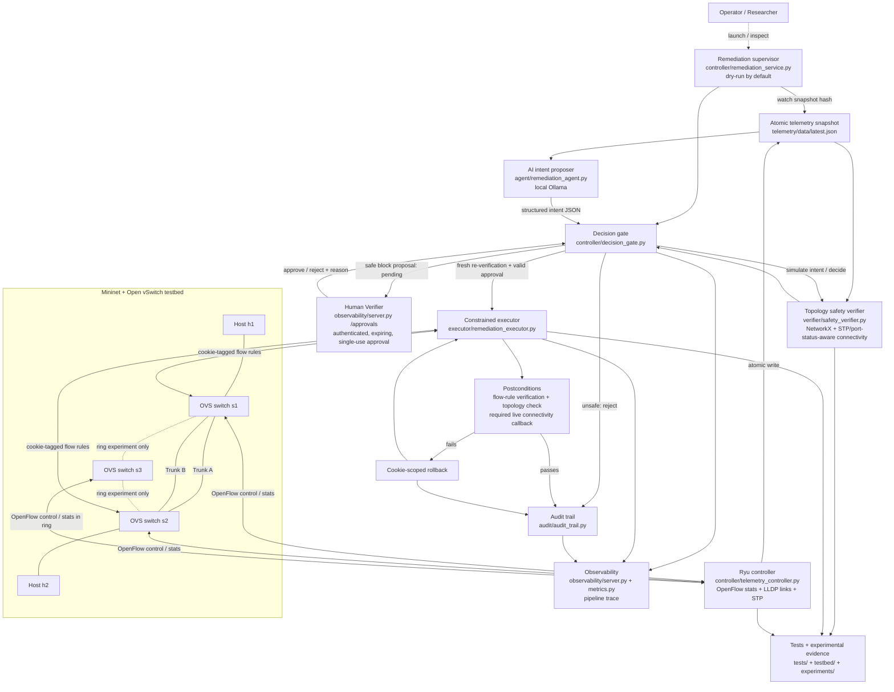

# Agentic AI-NetOps Guardrail - Full Architecture
Updated: 2026-10-27

## 1. Architecture diagram

The dashed ring links and s3 belong to the dedicated three-switch test. The primary redundant topology uses s1 and s2 connected by two trunks; all topologies are not necessarily running simultaneously.

## 2. Architectural planes

### Data plane
- Mininet hosts create traffic.
- Open vSwitch bridges forward packets using OpenFlow rules.
- Two inter-switch trunks create a redundant path.
- Ryu STP marks a port FORWARD or BLOCK to prevent Layer-2 loops.
- Mininet ping tests measure actual host connectivity.

### Control and safety plane
- Ryu collects port/flow stats, discovers links, records STP transitions and observes OpenFlow port-status events (UP/DOWN/MISSING).
- The controller publishes a timestamped telemetry snapshot through atomic file replacement at the project-local path by default, including when launched under sudo. The snapshot is readable by the project user.
- The topology builder converts switches, physical ports, links and STP state into a NetworkX graph.
- The local Ollama model proposes a structured action; its result is treated as untrusted input.
- The decision gate simulates the action against graph safety checks. Unsafe proposals are rejected; a safe block proposal is recorded as PENDING_HUMAN_APPROVAL and is not executed yet.
- The Human Verifier lives at observability/server.py (/approvals and /api/approvals). Operators authenticate with a server-configured bearer token and must approve/reject the exact intent, verifier result and topology fingerprint with a reason.
- Approval expires, is single-use, is recorded in the signed audit chain, and is revalidated against fresh telemetry immediately before execution. Missing, stale, changed or unaudited approval fails closed.
- The executor independently validates action and target, requires human approval and a live connectivity checker by default, supports trunk blocking, and rejects reroute.
- A block adds cookie-tagged drop rules at both ends of the selected inter-switch trunk. The executor verifies the rules and attempts transaction-scoped rollback if required.

### Evidence and operations plane
- The supervisor watches for changes to the telemetry snapshot and calls the pipeline. It defaults to dry-run.
- Execute mode requires an explicit environment-specific connectivity checker.
- The audit module writes tamper-evident decision records.
- Observability exposes metrics and pipeline traces.
- Pytest, synthetic cases and live Mininet tests provide different evidence types. Simulation results must not be presented as live OVS measurements.

## 3. End-to-end sequence

1. Ryu receives switch events and requests OpenFlow port/flow statistics.
2. Link discovery and STP events update telemetry.
3. Ryu atomically replaces the shared latest.json snapshot.
4. The supervisor notices a new content hash, or an operator invokes the decision gate directly.
5. The agent reads telemetry and asks local Ollama for a structured intent. Invalid output or agent errors default safely to no_action.
6. The safety gate builds a graph and simulates the proposed action. A trunk whose endpoints are not both reported FORWARD is not counted as an available forwarding path when STP telemetry is present.
7. An unsafe intent is rejected and audited; it must not mutate OVS.
8. For a safe block proposal, the gate writes a pending human-approval record; it does not mutate OVS.
9. The authenticated Human Verifier shows the exact action, verification findings, topology fingerprint and expiry; the administrator approves or rejects it with a reason.
10. The execution endpoint re-runs the decision gate, checks the current telemetry timestamp and topology fingerprint, verifies the approval's audit record, and hands the exact stored proposal to the executor.
11. The executor requires a live connectivity callback by default, installs cookie-scoped rules only after single-use approval consumption, and verifies both flow tables and the live connectivity postcondition.
12. Any failed required condition triggers an attempt to remove only the current transaction's rules, with rollback verification. Approval, execution, and rollback outcomes are recorded in the audit/trace path.

## 4. Main module responsibilities

| Component | Main responsibility |
|---|---|
| controller/telemetry_controller.py | Ryu app, OpenFlow statistics, LLDP/link discovery, STP state and atomic telemetry |
| telemetry/data/latest.json | Shared telemetry input; can still be stale or incomplete |
| agent/remediation_agent.py | Local Ollama intent proposal and output/target validation |
| verifier/safety_verifier.py | NetworkX topology model, connectivity/reachability, loop policy and simulated port removal |
| controller/decision_gate.py | Agent -> simulation -> REJECTED / PENDING_HUMAN_APPROVAL / re-verified execution -> audit/trace |
| controller/human_verifier.py | Expiring, topology-bound approval store; fingerprint validation and single-use consumption |
| /approvals UI and /api/approvals | Authenticated review, reasoned approve/reject, audit-backed execution route |
| executor/remediation_executor.py | Independent action validation, mandatory human approval by default, live-connectivity precondition, paired trunk rules, verification and rollback |
| controller/remediation_service.py | Snapshot watcher and pipeline supervisor; dry-run by default |
| audit/audit_trail.py | Tamper-evident decision/execution audit records |
| observability/server.py and metrics.py | Monitoring endpoints, metrics and trace visibility |
| testbed/ | Reproducible Mininet topology and live-integration tests |
| experiments/ | Synthetic evaluation, transaction benchmark and JSON/Markdown evidence |
| tests/ | Unit and regression coverage |

## 5. Trust boundaries and safety controls

- AI output is a proposal, never an executable command.
- The executor revalidates targets rather than trusting an APPROVED value alone.
- Access ports cannot be blocked by a trunk-block action.
- Unsupported reroute operations fail closed.
- Strict execution requires a live connectivity callback; the executor requires it by default for block operations.
- A block proposal cannot execute without an authenticated, exact-action, unexpired human approval and a matching signed audit record.
- Approval changes are serialized across worker processes, duplicate pending proposals are deduplicated, and approvals are consumed once.
- Telemetry snapshots carry an update timestamp; block proposals fail closed if the timestamp is missing or older than 30 seconds.
- Paired rules use transaction-scoped cookies and rollback.
- Atomic file replacement prevents partial JSON reads, but does not guarantee that all switches' observations were sampled at the same instant.
- A graph-based verifier is a topology abstraction, not a formal proof of every OpenFlow match/action behavior.

## 6. What the current tests establish

Verified:
- Dual-trunk baseline STP converged and host ping loss was 0%.
- The standby-trunk blocking test verified rules on both ends and retained host connectivity.
- With the alternate trunk STP-blocked, the gate and executor rejected a request to block the active trunk. No flow rules changed and connectivity remained intact.
- Access-port blocks were rejected without flow changes.
- The audit chain verified.
- The current unit suite passed 151 tests after Phase 1–3 changes (rerun recorded in the status report).
- Twelve manually labelled synthetic cases and thirty simulated executor transactions passed.

Still unresolved:
- The latest live triangle run used Mininet `configLinkStatus(..., "down")`; baseline ping loss was 0%, but the controller did not report an OpenFlow port DOWN/MISSING event, STP left the alternate blocked, and ping loss reached 100% during the 30-second failover window. Re-enabling the original link restored 0% loss; this is rollback/recovery, not successful automatic failover.
- A previous wrong telemetry destination under sudo was fixed: Ryu now writes to the project-local snapshot by default, adds an update timestamp, and makes the atomically replaced snapshot readable by the project user. The latest live test after this path fix still did not fail over.
- These are emulated/admin-down failures, not a physical cable-unplug test. Automatic active-link failover remains an open Phase 2 blocker.
- The approximately 0.26 ms executor benchmark uses an in-memory fake OVS runner; it is not real OVS latency.
- Production readiness is not established.
